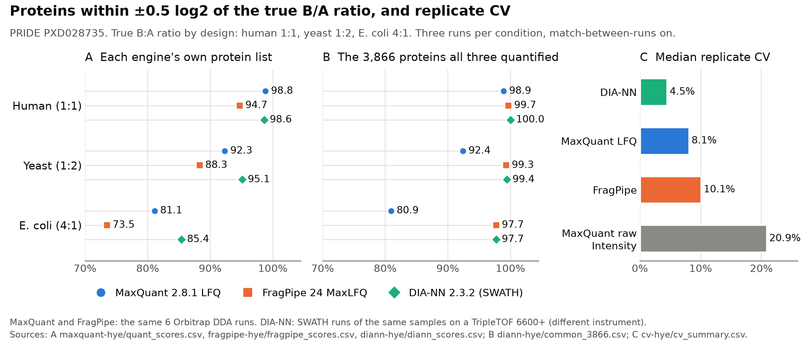

# sbmlab-benchmarks

[](https://doi.org/10.5281/zenodo.23355028)

## In 30 seconds



- MaxQuant 2.8.1 and FragPipe 24 searched the same six Orbitrap runs of a public human / yeast / *E. coli* mixture with known ratios (PRIDE PXD028735). On the 3,866 proteins all three engines quantified, 80.9% of *E. coli* proteins were within ±0.5 log2 of the true 4:1 ratio with MaxQuant LFQ and 97.7% with FragPipe.
- DIA-NN 2.3.2 ran on SWATH runs of the same samples from a different instrument (TripleTOF 6600+), so it is not a like-for-like engine test. It reported the most protein groups (8,987), and 85.4% of the 446 *E. coli* proteins it scored were within ±0.5.
- Median replicate CV: DIA-NN 4.5%, MaxQuant LFQ 8.1%, FragPipe 10.1%. MaxQuant raw Intensity, without LFQ normalisation: 20.9%.

Figure: A scores every protein an engine quantified in at least 2 of 3 runs per condition, so the counts differ (*E. coli*: 132 MaxQuant, 359 FragPipe, 446 DIA-NN). FragPipe scores many more low-abundance proteins, which is why its own-list share is lower than in B. B uses only the 3,866 proteins all three quantified. Numbers come from `maxquant-hye/quant_scores.csv`, `fragpipe-hye/fragpipe_scores.csv`, `diann-hye/diann_scores.csv` (A), `diann-hye/common_3866.csv` (B) and `cv-hye/cv_summary.csv` (C). `python docs/make_summary_figure.py` redraws it from those files (needs matplotlib).

### Reproduce one result in 10 minutes

The DIA-NN search itself took 6 h 17 min, but its protein matrix is in the repository, so the scoring step runs from bundled files. You need R and the `data.table` package; nothing is downloaded.

```bash
git clone https://github.com/shoo99/sbmlab-benchmarks
cd sbmlab-benchmarks/diann-hye
Rscript score_diann.R
```

It takes about a second (1.1 s here, R 4.3.3, data.table 1.16.2). Its first line should be:

```
pg_matrix (MBR, DIA-NN default filter): 8987 protein groups, 0 species-ambiguous, 95.0% cells with a value; human median -0.010
```

and the *E. coli* row of the results table (n, median log2 ratio, IQR, share within ±0.5) should be:

```
3: pg_matrix (MBR, DIA-NN default filter)   Ecoli   446  2.039 0.339      0.854
```

The full printout should match `score_diann.out` line for line; the script also rewrites `diann_scores.csv` with the same values. To start from the raw files instead, see [diann-hye/README.md](diann-hye/README.md) (30 GB from PRIDE).

## About

Scripts, settings and result tables behind the measured posts on [sbmlab.com](https://sbmlab.com/blog). Each folder is one post: the code I ran, the outputs it printed, and a README with versions and the traps I hit.

Most proteomics folders use the same public three-species benchmark with known ratios, so every tool is scored against a right answer rather than against another tool.

Everything ran in October 2026 on one workstation: an i9-14900K with 128 GB RAM, Linux tools in WSL2 (64 GB available) and DIA-NN natively on Windows. Paths inside scripts and logs (`/home/sysoft/...`, `C:\diann-hye\...`) are from that machine; change them to yours.

## Posts and folders

### Statistics: synthetic data with a known answer

| Folder | Post | What it shows |
|---|---|---|
| [limma-3v3-sim](limma-3v3-sim) | [Three samples per group: t-test vs limma](https://sbmlab.com/blog/three-samples-per-group-t-test-vs-limma-omics) | At 3 vs 3: Mann–Whitney min p = 0.10; t-test power 16 / 46 / 78% at d = 1 / 2 / 3. Simulation (400 features, 40 true): with p < 0.05 & ≥ 2-fold, false share t-test 18% vs limma 26%; BH 5% survivors 6.9 vs 16.1 at the same 6% false share |

### Proteomics: known-ratio benchmark (PRIDE PXD028735)

Human 65% in both conditions, yeast 30 → 15%, *E. coli* 5 → 20%, so the true log2(B/A) is 0 / −1 / +2. Three runs per condition.

| Folder | Post | What it shows |
|---|---|---|
| [maxquant-hye](maxquant-hye) | [MaxQuant 2.8 scored on known ratios](https://sbmlab.com/blog/maxquant-2-8-proteingroups-lfq-ibaq-mbr-scored-known-ratios-2026) | LFQ within ±0.5 of truth for 99 / 92 / 81% of human / yeast / *E. coli* proteins (raw intensity: 86 / 74 / 43%). Match-between-runs filled ~10% of peptide values; it made proteins quantified anyway more accurate, while proteins quantified only thanks to MBR were less reliable. The decoy column is now `Decoy`, not `Reverse` |
| [fragpipe-hye](fragpipe-hye) | [FragPipe vs MaxQuant](https://sbmlab.com/blog/fragpipe-vs-maxquant-2026-speed-benchmark) | Same 6 runs: 8.9 min by FragPipe's own timer (9.3 min wall clock in `time.log`, plus about 4 min raw → mzML in `convert.log`) vs 61.6 min. On the 3,877 proteins both quantified, within ±0.5: FragPipe 99.7 / 99.2 / 97.7% vs MaxQuant 98.9 / 92.2 / 80.9% |
| [diann-hye](diann-hye) | [DIA-NN on a known-answer benchmark](https://sbmlab.com/blog/diann-vs-maxquant-fragpipe-known-ratio-benchmark-2026) | DIA-NN 2.3.2 on the SWATH runs of the same samples (a different instrument): 8,987 protein groups; within ±0.5 98.6 / 95.1 / 85.4%. 6 h 17 min, ~3.5 h of it reading `.wiff` files |
| [limma-deqms-hye](limma-deqms-hye) | [limma vs DEqMS at small n](https://sbmlab.com/blog/limma-vs-deqms-proteomics-small-n-when-to-use-which-2026) | Unchanged human proteins called at adj. p < 0.05: t-test 68, limma 104, DEqMS 284 (an LFQ normalisation offset). With \|log2FC\| ≥ 0.5: 2 / 10 / 13 |
| [imputation-hye](imputation-hye) | [Imputation methods scored](https://sbmlab.com/blog/missing-values-proteomics-imputation-methods-compared) | Five imputation methods plus none. With a strict filter, imputation barely mattered. With a loose one it found more changes, doubled the false discoveries, and kNN erased a real 4-fold increase |
| [cv-hye](cv-hye) | [Replicate CV in three engines](https://sbmlab.com/blog/proteomics-cv-replicates-maxquant-fragpipe-diann-measured-2026) | Median replicate CV: DIA-NN 4.5%, MaxQuant LFQ 8.1%, FragPipe 10.1%, MaxQuant raw Intensity 20.9%. MaxQuant LFQ left 1,148 proteins with raw intensity in all 3 condition-A runs without 3 LFQ values; low CV predicted correct E. coli ratios (20–34 points higher for MaxQuant LFQ, FragPipe and DIA-NN; 7 points for MaxQuant raw Intensity) |
| [diann-quant-modes](diann-quant-modes) | [DIA-NN quantification modes on known ratios](https://sbmlab.com/blog/diann-quantums-vs-legacy-maxlfq-fragment-quantification-known-ratios-2026) | QuantUMS, high-accuracy, legacy MaxLFQ, fragment-level MaxLFQ/directLFQ and precursor sums on the same SWATH runs, MBR off and on. MBR off: *E. coli* within ±0.5 89.6–91.6% for DIA-NN's own modes. On *E. coli* proteins only quantified with MBR: QuantUMS 74.0%, legacy 62.4%, fragment routes 33–45% |
| [string-hubs](string-hubs) | [STRING confidence score and hub proteins, measured](https://sbmlab.com/blog/string-confidence-score-hub-proteins-measured-2026) | STRING 12.5 human: score formula reproduced for all 5.4M pairs; 37% of links at 0.4 need text mining; top hub at 0.4 (TRIM67) has 17 PubMed records; partners predict core-essential genes beyond papers and expression (AUC 0.83 vs 0.71); random detected lists 'significantly connected' 20/20 with genome background, 0/20 with detected background |
| [de-pipeline-check](de-pipeline-check) | [Differential expression in R](https://sbmlab.com/blog/differential-expression-proteomics-complete-r-pipeline) | Every R block of the post, run on the benchmark table (except the symbol-based enrichGO block) |
| [string-background](string-background) | [STRING enrichment background test](https://sbmlab.com/blog/string-enrichment-background-random-proteins-test-2026) | Random lists of detected proteins: median 103 "significant" GO/KEGG terms with STRING's default whole-genome background, 0 with the detected proteins as background |
| [r-vs-python-read-bench](r-vs-python-read-bench) | [R vs Python for bioinformatics](https://sbmlab.com/blog/r-vs-python-bioinformatics-guide-2026) | Reading and summarising a 146 MB MaxQuant `evidence.txt`: data.table 0.04 s, polars 0.16 s, pandas 0.51 s, base R 5.8 s |

### Preprint analyses

The proteomics folders above are written up as a preprint:

Kang, B. (2026). Scoring the downstream chain of small-n label-free proteomics against known ratios: search engine, match-between-runs, imputation, differential testing and enrichment background on a public three-species benchmark. *Research Square* (preprint, not peer reviewed). https://doi.org/10.21203/rs.3.rs-11370244/v1


| Folder | What it adds |
|---|---|
| [preprint-hye](preprint-hye) | t-test / limma / DEqMS on the protein tables of all three engines (contaminants removed by accession), with and without an extra median normalisation; figure script for the preprint. Needs MaxQuant's `bin/conf/contaminants.fasta` copied next to the scripts as `contaminants_maxquant_2.8.1.fasta`; input paths at the top of each script point to the local MaxQuant, FragPipe and DIA-NN outputs |

### Other measured posts

| Folder | Post | Data | What it shows |
|---|---|---|---|
| [wgcna-cptac-ccrcc](wgcna-cptac-ccrcc) | [Does WGCNA really work?](https://sbmlab.com/blog/does-wgcna-really-work-public-proteomics-end-to-end) | CPTAC ccRCC proteome (110 tumours) + TJ-RCC | Independent re-run of the post's numbers: 15 modules, 7 linked to grade at p < 0.05 but only 2 beat size-matched random sets; the strongest tracks endothelial markers (r 0.91) and drops from −0.46 to −0.21 after adjustment |
| [biomarker-leakage](biomarker-leakage) | [Data leakage with shuffled labels](https://sbmlab.com/blog/biomarker-discovery-data-leakage-shuffled-labels-auc-2026) | Bader et al. 2020 CSF proteome | Labels shuffled, proteins chosen before cross-validation: mean AUC 0.73. Done properly: 0.51 |
| [mrna-protein-wang2019](mrna-protein-wang2019) | [Proteomics vs genomics: mRNA vs protein](https://sbmlab.com/blog/proteomics-vs-genomics-differences) | Wang et al. 2019, 29 human tissues | mRNA explains ~29% of protein variation within a tissue; a gene's mRNA and protein track each other across tissues with median Spearman 0.35 |
| [bioinfo-db-check](bioinfo-db-check) | [13 bioinformatics databases, tested](https://sbmlab.com/blog/top-10-bioinformatics-databases-every-researcher-should-know) | Live public APIs | One protein (SOD1) through 13 APIs: what each returns, speed, failures, release, licence |
| [deseq2-edger-limma-airway](deseq2-edger-limma-airway) | [DESeq2 vs edgeR vs limma](https://sbmlab.com/blog/deseq2-vs-edger-vs-limma-rna-seq-comparison) | Bioconductor `airway` | The design (pairing by cell line) changed the results more than the choice of tool |
| [scrna-pbmc3k](scrna-pbmc3k) | [Single-cell RNA-seq on PBMC3k](https://sbmlab.com/blog/single-cell-rna-seq-analysis-complete-guide-2026) | 10x PBMC3k | Scanpy from QC to marker genes in ~23 s; two dependencies that are not installed by default |
| [biomart-pig-mouse](biomart-pig-mouse) | [BioMart pig ↔ mouse orthologues](https://sbmlab.com/blog/biomart-pig-mouse-ortholog-mapping-tutorial-2026) | Ensembl 111 and 116 | 1:1 orthologue tables, and why biomaRt failed where a plain martservice query worked |

A summary of all the tools, versions and timings is in [Best bioinformatics tools in 2026, installed and timed](https://sbmlab.com/blog/best-bioinformatics-tools-2026).

## What is not here

- **Raw data.** Download it from the source in each folder's README: PRIDE PXD028735, the journals' supplementary files, Bioconductor, 10x Genomics, Ensembl.
- **Third-party tables I only read**, such as the paper supplements and the raw API responses (KEGG does not allow redistribution). The scripts regenerate what they need.
- **Large logs and intermediate files.**

## Data sources and licences

- PXD028735: Van Puyvelde B. et al. (2022) *Scientific Data* 9:126, CC BY 4.0.
- Bader J.M. et al. (2020) *Molecular Systems Biology* 16:e9356, CC BY (open access, licence as listed by Europe PMC).
- Wang D. et al. (2019) *Molecular Systems Biology* 15:e8503, CC BY (open access, licence as listed by Europe PMC).
- `airway` (Himes et al. 2014) via Bioconductor; PBMC3k from 10x Genomics; Ensembl and STRING data under their own terms (see their websites).
- The STRING enrichment tables in `string-background` include KEGG pathway names returned by STRING.

Code in this repository is MIT licensed ([LICENSE](LICENSE)). Result tables derived from the datasets above keep those datasets' licences; please cite the original papers.

Found a mistake? Open an issue. These are single runs on one machine, so differences on your setup are expected and interesting.

## How to cite

Kang, B. (2026). *sbmlab-benchmarks: scripts and results behind the measured posts on sbmlab.com*. Zenodo. https://doi.org/10.5281/zenodo.23355028

This DOI always points to the latest version (v1.0.4: https://doi.org/10.5281/zenodo.23791962; v1.0.3: https://doi.org/10.5281/zenodo.23384376; v1.0.2: https://doi.org/10.5281/zenodo.23356112; v1.0.1: https://doi.org/10.5281/zenodo.23355544; v1.0.0: https://doi.org/10.5281/zenodo.23355029). Please also cite the original datasets listed above.

If you use the proteomics benchmark results, please cite the preprint as well:

Kang, B. (2026). Scoring the downstream chain of small-n label-free proteomics against known ratios: search engine, match-between-runs, imputation, differential testing and enrichment background on a public three-species benchmark. *Research Square* (preprint, not peer reviewed). https://doi.org/10.21203/rs.3.rs-11370244/v1
