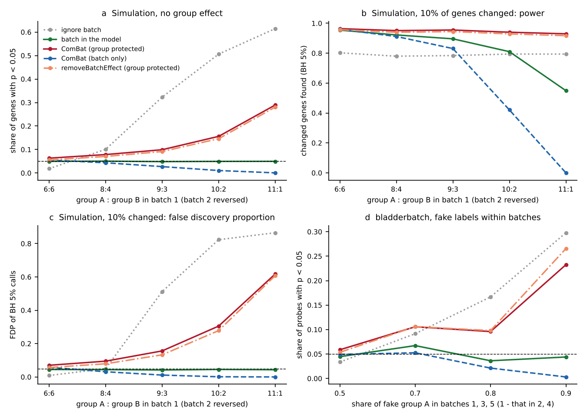

# Batch correction with unbalanced designs: false confidence after ComBat (2026-11-03)

Tracking issue: [#8](https://github.com/shoo99/sbmlab-benchmarks/issues/8). No post yet.

A common workflow corrects batch effects first, with ComBat or `removeBatchEffect` protecting the group variable, and then tests the "clean" data. When groups are spread unevenly over batches, this creates false significance. Nygaard et al. (2016, *Biostatistics* 17:29–39) showed the problem; here it is measured.

The tables give values at the balanced and the most confounded designs; `batch_study.out` has every level.

- **Simulation, no group effect** (expected share of genes with p < 0.05 is 0.05):
  - ComBat with group protected: 0.063 balanced (6:6 per batch) → 0.289 nearly confounded (11:1)
  - `removeBatchEffect` with group protected: 0.055 → 0.281
  - limma with batch in the model: 0.050 at every level
- **Simulation, 10% of genes changed**: at 11:1, the BH 5% calls after protected correction are 61–62% false. With batch in the model they stay 4.3% false, at lower but honest power.
- **Real null** (bladderbatch, fake labels): at the strongest imbalance, protected correction gave 404–563 false BH discoveries per repetition. Batch in the model gave 0.4.

## Data

- **Simulation** (`batch_study.R`, part 1):
  - 1,000 genes, 2 batches of 12 samples, 12 samples per group in total
  - batch 1 holds k samples of group A and 12 − k of B, batch 2 the reverse: k = 6 (balanced), 8, 9, 10, 11
  - each gene has its own batch location (SD 0.6 log2) and batch scale (log-normal, SD 0.25), on top of residual SD 0.4 (log-normal across genes)
  - 40 repetitions per setting, seed 2026
- **bladderbatch** (part 2): the Bioconductor data package `bladderbatch` 1.40.0. It holds 57 bladder samples on Affymetrix arrays (22,283 probes) in 5 batches of 11 / 18 / 4 / 5 / 19, from Dyrskjøt et al. 2004.
  - We use the 5,000 probes with the highest mean.
  - Biology and batch are entangled in this data set: batch 3 is all normal, batch 4 all biopsy, batch 1 all cancer.
  - The data are loaded from the package and are not copied here.

## Truth

- **Null, simulation**: no group effect, so every call is false.
- **Null, bladderbatch**: in each repetition, fake group labels are assigned at random within each batch. The share of A is p in batches 1, 3 and 5 and 1 − p in batches 2 and 4, for p = 0.5 (balanced), 0.7, 0.8, 0.9. Given batch, the labels carry no biology, so every call is false. 30 repetitions per p, seed 2027.
- **Planted**: 10% of genes change by ±1 log2 between groups. Power and FDP are measured against these genes.

## Tools

R 4.3.3, limma 3.58.1, sva 3.50.0, bladderbatch 1.40.0 (Ubuntu 24.04 packages, the same as CI). Every method ends in limma `lmFit` + `eBayes` on the group coefficient, with BH across genes:

| Method | Before testing | Test model |
|---|---|---|
| ignore batch | — | `~ group` |
| batch in the model | — | `~ batch + group` |
| ComBat (group protected) | `sva::ComBat(mod = ~ group)` | `~ group` |
| ComBat (batch only) | `sva::ComBat(mod = NULL)` | `~ group` |
| removeBatchEffect (group protected) | `limma::removeBatchEffect(design = ~ group)` | `~ group` |

## How to run

```bash
Rscript batch_study.R > batch_study.out
```

```bash
python3 figure.py
```

`batch_study.R` takes about 3 minutes and writes `scores.csv`. `figure.py` draws `batch_correction_unbalanced.png` from `scores.csv`. CI re-runs `batch_study.R` and compares both outputs with the bundled files byte for byte.

## Results



**Simulation, no group effect.** Values are balanced (6:6) → nearly confounded (11:1).

| Method | Share p < 0.05 (expected 0.05) | Repetitions with any BH discovery (should be ≤ 0.05) |
|---|---|---|
| ignore batch | 0.019 → 0.615 | 0.025 → 1.00 |
| batch in the model | 0.050 → 0.050 | 0.10 → 0.075 |
| ComBat (group protected) | 0.063 → 0.289 | 0.15 → 1.00 |
| ComBat (batch only) | 0.055 → 0.001 | 0.15 → 0 |
| removeBatchEffect (group protected) | 0.055 → 0.281 | 0.15 → 1.00 |

**Simulation, 10% of genes changed by ±1 log2.** Values are 6:6 → 11:1.

| Method | Power at BH 5% | FDP at BH 5% (target 0.05) |
|---|---|---|
| ignore batch | 0.80 → 0.79 | 0.009 → 0.87 |
| batch in the model | 0.95 → 0.55 | 0.045 → 0.043 |
| ComBat (group protected) | 0.96 → 0.93 | 0.070 → 0.62 |
| ComBat (batch only) | 0.96 → 0 | 0.058 → 0 |
| removeBatchEffect (group protected) | 0.96 → 0.92 | 0.057 → 0.61 |

**bladderbatch, fake labels within batches.** Values are p = 0.5 → p = 0.9.

| Method | Share p < 0.05 | Repetitions with any BH discovery | BH discoveries per repetition |
|---|---|---|---|
| ignore batch | 0.034 → 0.298 | 0 → 0.77 | 0 → 414 |
| batch in the model | 0.045 → 0.044 | 0.033 → 0.033 | 0.1 → 0.4 |
| ComBat (group protected) | 0.059 → 0.233 | 0.13 → 0.97 | 2.3 → 404 |
| ComBat (batch only) | 0.049 → 0.003 | 0.10 → 0 | 1.1 → 0 |
| removeBatchEffect (group protected) | 0.054 → 0.266 | 0.10 → 1.00 | 1.6 → 563 |

All numbers are in `scores.csv` (standard format, written with `common/known_ratio.R`) and `batch_study.out`.

What the numbers say:

- **Protected correction overstates confidence, and more so as imbalance grows.** The corrected data are tested as if they were clean, so the uncertainty in the batch estimates and the degrees of freedom they used are ignored. The apparent power stays high (0.92–0.93 at 11:1) because the false calls inflate it.
- **Batch in the model is the method that holds its error rates**: share p < 0.05 of 0.048–0.051 at every level, FDP 0.042–0.045. Its power falls with confounding, from 0.95 to 0.55. That is the information really lost when group and batch overlap.
- **ComBat without the group in `mod`** removes real group differences along with batch when the two overlap. It looks safe under the null and finds nothing (power 0) at 11:1.
- **Ignoring batch** is the worst when the design is unbalanced, because the batch difference becomes a group difference.

## Traps

- limma's own help page for `removeBatchEffect` says it is not intended to be used before linear modelling, and that batch should go into the model instead. The protected `removeBatchEffect` → `lmFit` route measured here is exactly that misuse.
- ComBat prints progress messages to the console; `batch_study.R` silences them so that the printout stays comparable in CI.
- **Uncertainty.** With 40 repetitions, a share of repetitions has a 95% interval of about ±0.07. The 0.10 for batch in the model at 6:6 is 4 of 40, not a failure of BH. bladderbatch probes are correlated and the per-repetition counts are heavy-tailed, so read the trend over p rather than single cells. The dip between p = 0.7 and 0.8 for the correction methods comes from how the small batches (4 and 5 arrays) round to whole samples.

## Not included

The bladderbatch expression data; they are loaded from the Bioconductor package.
