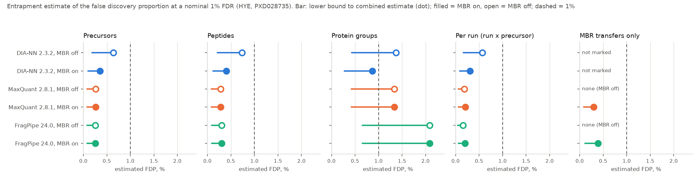

# True FDR of MaxQuant, FragPipe and DIA-NN measured with an entrapment database (2026-11-04)

Tracking issue: [#5](https://github.com/shoo99/sbmlab-benchmarks/issues/5). No post yet.

At a nominal 1% FDR, how many identifications are actually false? This folder answers it at the precursor, peptide and protein level, with MBR off and on. The method: search the PXD028735 HYE runs against the human / yeast / *E. coli* database **plus proteins that cannot be in the sample**. Any hit on those entrapment proteins is known to be false.

**Status: ready for a workstation run.**

- The database builder, the extraction from all three engines' outputs and the FDP estimates are tested on synthetic data in CI.
- The searches themselves need the raw files (30 GB for SWATH, 22 GB for Orbitrap) and hours of CPU. That is beyond this repository's cloud environment, so there are no real-data numbers yet.

## Data

- **Raw files**: PRIDE PXD028735 (Van Puyvelde et al. 2022, *Sci Data*; CC BY 4.0). These are the same runs as the existing folders:
  - MaxQuant and FragPipe: the 6 Orbitrap DDA runs of [`maxquant-hye`](../maxquant-hye) and [`fragpipe-hye`](../fragpipe-hye), `Condition_{A,B}_Sample_{Alpha,Beta,Gamma}_01`
  - DIA-NN: the 6 SCIEX SWATH runs of [`diann-hye`](../diann-hye)

  The two engines therefore see different acquisitions of the same samples. Compare MBR off vs on within an engine, and compare engines with that in mind.
- **Target database**: UniProt Swiss-Prot human 9606 + yeast 559292 + *E. coli* 83333. Use the 31,695-entry file of the earlier searches (`TARGET_FASTA=…/hye_sp.fasta`), so that only the entrapment differs.
- **Entrapment** (`make_entrapment.py`), one of:
  - **foreign** (default): UniProt Swiss-Prot *Arabidopsis thaliana* (3702). A plant proteome cannot be in a human / yeast / bacterial mixture. Proteins that share any tryptic peptide with the targets are dropped (conserved histones, ubiquitin, actin, and so on), so that no entrapment peptide can be a true identification.
  - **shuffle**: one shuffled copy of each target protein. Within each tryptic peptide, the residues other than K, R and P are shuffled. Masses, cleavage sites and lengths stay the same, and r ≈ 1.

  Peptides are compared after I → L. The tryptic rule matches the search settings: trypsin, no missed cleavage for this comparison, 7–30 aa.
- **Bundled after the run**: `entrapment_info.json` records the counts and r (protein and peptide ratio). `counts.csv`, written by `extract.py`, holds the counts per search, level and threshold. Both are small. The search outputs themselves are not bundled.

## Truth and estimates

Following Wen et al. (2025, *Nat Methods*). At a threshold, let N_T be the target identifications, N_E the entrapment identifications, and r the entrapment-to-target size ratio. r is taken in peptides for the precursor and peptide levels, and in proteins for the protein level.

| Estimate | Formula | Meaning |
|---|---|---|
| `fdp_lower` | N_E / (N_T + N_E) | a lower bound: every entrapment hit is false, and some target hits are too |
| `fdp_combined` | N_E (1 + 1/r) / (N_T + N_E) | the combined estimate: false target hits are expected at about N_E / r |

- **Reading them**: a tool controls its FDR if `fdp_combined` stays at or below the nominal level. A `fdp_lower` above the nominal level shows a failure for certain.
- **Paired estimator**: the paired estimator of Wen et al. needs scores of non-discovered candidates and a paired (shuffled) database. It is not implemented.
- **Cost of the larger database**: `share_targets_lost` = 1 − N_T / (targets of the same search against the target database alone).

**Classification**:

- An identification is **entrapment** when every protein it maps to is an entrapment protein (accession contains `ENTRAP_`).
- Peptides shared with a target count as **target**, the conservative choice.
- **Decoys** (`rev_`, `REV__`, `DECOY`) and **contaminants** (`CON__`, `contam_`) are not counted. MaxQuant's `Decoy` column (2.8) and `Reverse` column (older versions) are both honoured.

**Thresholds**: DIA-NN reports q-values for precursors and protein groups, so `extract.py` counts at q ≤ 0.001, 0.005, 0.01, 0.02 and 0.05, as far as the report reaches. MaxQuant and FragPipe write only what passes their FDR, so their counts are "as reported" at 1%; MaxQuant protein groups also use the `Q-value` column.

**Per-run levels** (added 2026-11-14): the precursor, peptide and protein levels count each identification once for the whole experiment. Match-between-runs adds no sequence to that list; it copies identifications into runs where the precursor had no MS/MS. So those levels cannot show what MBR does, and for MaxQuant they come out identical with MBR on and off. Two levels count per run instead:

| Level | DIA-NN | MaxQuant | FragPipe |
|---|---|---|---|
| `precursor_run` | report rows (run, precursor) at their run-level `Q.Value` | `evidence.txt` rows (raw file, modified sequence, charge), MS/MS and MBR | `combined_ion.tsv` (sample, modified sequence, charge) with match type MS/MS, MBR or MBC |
| `precursor_run_mbr` | not available: DIA-NN does not mark transfers | transfers only: `Type` MULTI-MATCH, which MaxQuant 2.8 writes as an empty `Type` (with a `Match time difference` and no MS/MS) | match type MBR |

- MULTI-MATCH-NOVERIFY rows (MaxQuant) and `unmatched` ions (FragPipe) are left out.
- **MBC** is IonQuant's label for ions quantified in a run without MS/MS there. IonQuant does not document it, but it is not MBR: the FragPipe runs here have 12,440 MBC ions with MBR off and the same 12,440 with MBR on. It is counted in `precursor_run`, not as a transfer.
- r for both levels is the peptide ratio.

## How to run (workstation)

1. **Databases**:

   ```bash
   TARGET_FASTA=/path/to/hye_sp.fasta bash make_db.sh foreign
   ```

   This writes `db/target_plus_entrapment.fasta` and `db/entrapment_info.json`. `bash make_db.sh shuffle` builds the shuffled variant instead.

2. **Searches**: run each engine twice, MBR on and off, against `db/target_plus_entrapment.fasta`. For the targets lost, also search `db/target.fasta`. Keep every other setting as in the earlier folders:
   - **DIA-NN**: `DIANN=/path/to/diann bash run_diann.sh /path/to/swath_raw 24`. This is the diann-hye command with the new FASTA and a new predicted library. Expect 6–11 h per search on 24 threads (MBR off with `--use-quant` reuses the MBR-on first pass and takes minutes).
   - **MaxQuant 2.8.1**: start from `maxquant-hye/mqpar.xml` (MBR on) and `mqpar_nombr.xml` (MBR off). Keep the three species FASTA entries and add `db/entrapment.fasta` as a fourth `FastaFileInfo` entry with the same identifier rule (`>[^|]*\|(.*?)\|`, which reads `ENTRAP_P12345`). 6–11 h each here (16 threads, sharing the machine).
   - **FragPipe 24**: add decoys and contaminants as before:

     ```bash
     philosopher database --custom db/target_plus_entrapment.fasta --contam
     ```

     Then set `database.db-path` in `fragpipe-hye/hye_lfq_mbr.workflow`. For MBR off, set `ionquant.mbr=0`. About 15 min each. Keep the FragPipe work folder on the same file system as the mzML files: on a Windows drive mounted in WSL, FragPipe's "move pepxml" step fails with `Operation not permitted`.

3. **Count and score**: copy `searches.example.tsv` to `searches.tsv` and adjust the paths and versions, then:

   ```bash
   python3 extract.py searches.tsv
   ```

   ```bash
   python3 score.py > score.out
   ```

   `extract.py` reads DIA-NN `report.tsv` or `report.parquet` (parquet needs pandas with pyarrow), the MaxQuant `combined/txt` folder, and the FragPipe output folder (every `psm.tsv`, `peptide.tsv`, `protein.tsv` and `combined_ion.tsv` below it).

4. **Bundle**: `counts.csv`, `db/entrapment_info.json` (copied next to the scripts), `score.out` and `scores.csv`. Note r and the entrapment source in this README. Then switch `ci` to `reproduce` with a `score.py` re-run in `ci/reproduce.sh`.

**CI** runs `test/test_synthetic.py`. It takes under a second and checks 35 known answers:
- the foreign builder drops planted shared proteins and leaves no shared peptide
- the shuffled copies keep length, composition and cleavage sites
- the DIA-NN, MaxQuant and FragPipe readers count planted target and entrapment hits exactly, leaving out decoys and contaminants
- the per-run levels count planted MS/MS and MBR identifications per run exactly, and transfers leave the experiment-wide counts unchanged
- `score.py`'s estimates equal the formulas

## Results

Run on a workstation (WSL2, 32 cores) on 2026-11-13 and 14, with the foreign (Arabidopsis) entrapment: 14,567 entrapment proteins next to 31,695 targets (1,854 Arabidopsis proteins dropped for sharing a tryptic peptide), r = 0.4065 for peptides and 0.4596 for proteins. Target-only searches: DIA-NN MBR on and off from `diann-hye`, MaxQuant MBR off from `maxquant-hye`, FragPipe MBR on from `fragpipe-hye`, and MaxQuant MBR on and FragPipe MBR off run here. Every search used the settings of those folders; only the database changed.



**At the nominal 1%** (DIA-NN q ≤ 0.01; MaxQuant and FragPipe as reported), `fdp_combined` with `fdp_lower` in brackets:

| Search | Precursors | Peptides | Protein groups | Per run | MBR transfers only |
|---|---|---|---|---|---|
| DIA-NN 2.3.2, MBR off | 0.64% (0.18%) | 0.74% (0.21%) | **1.37%** (0.43%) | 0.57% (0.16%) | not marked |
| DIA-NN 2.3.2, MBR on | 0.35% (0.10%) | 0.40% (0.12%) | 0.87% (0.27%) | 0.31% (0.09%) | not marked |
| MaxQuant 2.8.1, MBR off | 0.26% (0.08%) | 0.28% (0.08%) | **1.33%** (0.42%) | 0.19% (0.06%) | none |
| MaxQuant 2.8.1, MBR on | 0.26% (0.08%) | 0.28% (0.08%) | **1.33%** (0.42%) | 0.21% (0.06%) | 0.30% (0.09%) |
| FragPipe 24.0, MBR off | 0.26% (0.07%) | 0.30% (0.09%) | **2.09%** (0.66%) | 0.15% (0.05%) | none |
| FragPipe 24.0, MBR on | 0.26% (0.07%) | 0.30% (0.09%) | **2.09%** (0.66%) | 0.20% (0.06%) | 0.39% (0.11%) |

- **Precursors and peptides: every engine stays within 1%**, at 0.26–0.74% estimated.
- **Protein groups: three of the six searches are estimated above 1%.**
  - FragPipe has 52 entrapment groups among 7,913 (2.09%). MaxQuant has 23 among 5,481 (1.33%). DIA-NN with MBR off has 37 among 8,558 (1.37%).
  - No lower bound reaches 1% (at most 0.66%), so none is a certain failure.
  - FragPipe's per-experiment protein lists add up to exactly its combined list (Philosopher filters each experiment against the same `combined.prot.xml`). The 2.09% is therefore not an effect of taking the union over experiments.
- **MBR transfers are not where the errors are.**
  - MaxQuant copied 60,189 identifications between runs, 52 of them entrapment (0.30%). FragPipe copied 78,227, 88 of them entrapment (0.39%).
  - That is 1.6 and 2.5 times the per-run rate with MBR off (0.19% and 0.15%), and still well below 1%.
  - MaxQuant and FragPipe give the same experiment-wide counts with MBR on and off. Their MBR copies identifications into other runs for quantification; the identification lists come from the same search.
- **DIA-NN with MBR on has fewer entrapment hits than with MBR off** at every level (precursors 100 against 189). A likely reason: MBR on re-searches all runs with a library built from the first pass, so an entrapment precursor must survive that pass to be searched again.
- **The larger database costs identifications**, measured against the target-only searches:
  - DIA-NN: 8.3–8.5% of its precursors (9–10% per run)
  - MaxQuant: 3.5–4.0%
  - FragPipe: 1.2%

  The entrapment adds 41% more peptides to score against.

| Run time on this workstation | Wall time |
|---|---|
| DIA-NN MBR on (24 threads, alongside MaxQuant) | 10 h 57 min |
| DIA-NN MBR off (`--use-quant`) | 3 min 42 s |
| MaxQuant (16 threads): entrapment MBR on (alongside DIA-NN), MBR off, target-only MBR on | 10 h 40 min, 5 h 42 min, 5 h 54 min |
| FragPipe (8 threads): three searches | 14–16.5 min each |

Bundled: `counts.csv` (from `extract.py`), `entrapment_info.json`, `score.out` and `scores.csv`. The search outputs are not bundled. CI re-runs `score.py` from `counts.csv` and compares `score.out` and `scores.csv` byte for byte.

## Traps

- **The size ratio r matters more than it looks.**
  - With r = 0.5, every entrapment hit stands for three false hits in `fdp_combined`; with r = 1, for two.
  - The foreign proteome's r depends on how many plant proteins survive the shared-peptide filter, so read it from `entrapment_info.json`. Do not assume it from the protein counts.
- **Entrapment proteins change the search.** A larger database lowers scores and can cost true identifications. That is why the target-only search is part of the design (`share_targets_lost`).
- **MaxQuant 2.8 renamed `Reverse` to `Decoy`.** A filter on `Reverse` alone keeps every decoy (see `maxquant-hye`). `extract.py` checks both.
- **FragPipe's contaminants carry no `contam_` prefix** (in `fragpipe-hye` and in this run's `philosopher database --contam` output), so its target counts include contaminants. This does not change the entrapment count and lowers FragPipe's estimates very slightly.
- **The protein-level estimate is the roughest.** The combined estimator assumes a false hit lands on an entrapment sequence in proportion to r. At the protein level, protein length, grouping and the minimum number of peptides make that assumption looser than for precursors.

## Files

| File | Content |
|---|---|
| `make_db.sh` | downloads the target and Arabidopsis FASTAs and builds the databases (`db/`, not tracked) |
| `make_entrapment.py` | entrapment builder: foreign proteome or shuffled targets |
| `run_diann.sh` | DIA-NN searches with the diann-hye settings, MBR on and off |
| `searches.example.tsv` | manifest template for `extract.py` |
| `extract.py` | target and entrapment counts per search, level and threshold → `counts.csv` |
| `score.py` | FDP estimates and targets lost → `scores.csv` |
| `figure.py` | `entrapment_fdr_hye.png` from `scores.csv` |
| `test/test_synthetic.py` | known-answer test of the three scripts (CI) |
