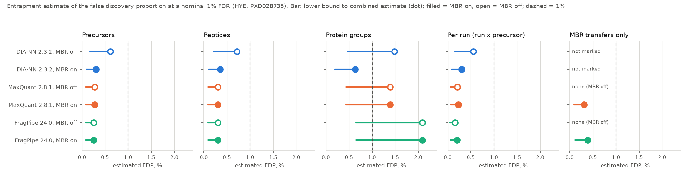
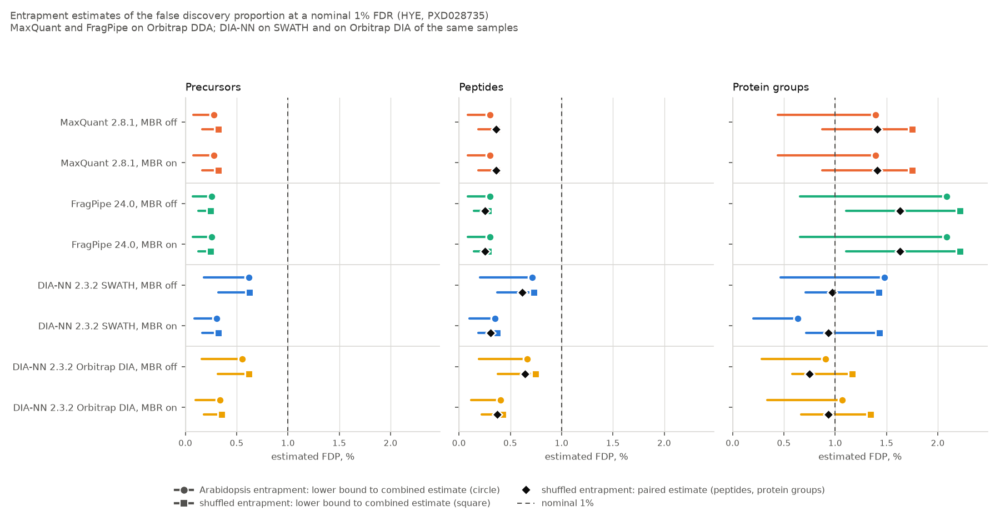

# True FDR of MaxQuant, FragPipe and DIA-NN measured with an entrapment database (2026-11-04)

Tracking issue: [#5](https://github.com/shoo99/sbmlab-benchmarks/issues/5). Post: [Is 1% FDR Really 1%?](https://sbmlab.com/blog/entrapment-fdr-maxquant-fragpipe-diann-1-percent-measured-2026).

At a nominal 1% FDR, how many identifications are actually false? This folder answers it at the precursor, peptide and protein level, with MBR off and on. The method: search the PXD028735 HYE runs against the human / yeast / *E. coli* database **plus proteins that cannot be in the sample**. Any hit on those entrapment proteins is known to be false.

**2026-11-23: re-run on verified raw files.** The first PRIDE downloads had short server error messages written into some raw files (Orbitrap: 2 of 6 files, one damaged spectrum each; SWATH: 5 of 6 `.wiff.scan` files, 14 damaged spectra). All 12 entrapment searches and the four DIA-NN and MaxQuant target-only searches were re-run on verified copies with the same settings and databases. FragPipe's outputs came out byte-identical, so its numbers are unchanged. Main changes at 1%: DIA-NN protein groups with the Arabidopsis entrapment 1.37% → 1.48% (MBR off) and 0.87% → 0.63% (MBR on); with the shuffled entrapment, the paired protein-group estimate 1.02% → 0.97% for DIA-NN MBR off and 1.47% → 1.41% for MaxQuant.

**Status: searched and scored on a workstation** (results below).

- The database builder, the extraction from all three engines' outputs and the FDP estimates are tested on synthetic data in CI.
- The searches themselves need the raw files (30 GB for SWATH, 22 GB for Orbitrap) and hours of CPU, so they ran on a workstation and only their counts are bundled.

## Data

- **Raw files**: PRIDE PXD028735 (Van Puyvelde et al. 2022, *Sci Data*; CC BY 4.0). These are the same runs as the existing folders:
  - MaxQuant and FragPipe: the 6 Orbitrap DDA runs of [`maxquant-hye`](../maxquant-hye) and [`fragpipe-hye`](../fragpipe-hye), `Condition_{A,B}_Sample_{Alpha,Beta,Gamma}_01`
  - DIA-NN: the 6 SCIEX SWATH runs of [`diann-hye`](../diann-hye)
  - DIA-NN, added 2026-11-18: the 6 Orbitrap DIA runs of the same samples, `LFQ_Orbitrap_AIF_Condition_{A,B}_Sample_{Alpha,Beta,Gamma}_01` (see [DIA-NN on the Orbitrap DIA runs](#dia-nn-on-the-orbitrap-dia-runs-2026-11-18))

  On SWATH, DIA-NN sees a different acquisition of the same samples than MaxQuant and FragPipe. Compare MBR off vs on within an engine, and compare engines with that in mind. The Orbitrap DIA searches remove the instrument difference, but DIA and DDA still differ.
- **Target database**: UniProt Swiss-Prot human 9606 + yeast 559292 + *E. coli* 83333. Use the 31,695-entry file of the earlier searches (`TARGET_FASTA=…/hye_sp.fasta`), so that only the entrapment differs.
- **Entrapment** (`make_entrapment.py`), one of:
  - **foreign** (default): UniProt Swiss-Prot *Arabidopsis thaliana* (3702). A plant proteome cannot be in a human / yeast / bacterial mixture. Proteins that share any tryptic peptide with the targets are dropped (conserved histones, ubiquitin, actin, and so on), so that no entrapment peptide can be a true identification.
  - **shuffle**: one shuffled copy of each target protein. Within each tryptic peptide, the residues other than K, R and P are shuffled. Masses, cleavage sites and lengths stay the same, and r ≈ 1.

  Peptides are compared after I → L. The tryptic rule matches the search settings: trypsin, no missed cleavage for this comparison, 7–30 aa.
- **Bundled after the run**: `entrapment_info.json` records the counts and r (protein and peptide ratio). `counts.csv`, written by `extract.py`, holds the counts per search, level and threshold. Both are small. The search outputs themselves are not bundled.

## Truth and estimates

Following Wen et al. (2025, *Nat Methods*). At a threshold, let N_T be the target identifications, N_E the entrapment identifications, and r the entrapment-to-target size ratio. r is taken in peptides for the precursor and peptide levels, and in proteins for the protein level.

| Estimate | Formula | Meaning |
|---|---|---|
| `fdp_lower` | N_E / (N_T + N_E) | a lower bound: every entrapment hit is false, and some target hits are too |
| `fdp_combined` | N_E (1 + 1/r) / (N_T + N_E) | the combined estimate: false target hits are expected at about N_E / r |

- **Reading them**: a tool controls its FDR if `fdp_combined` stays at or below the nominal level. A `fdp_lower` above the nominal level shows a failure for certain.
- **Paired estimator** (`paired.py`, shuffled entrapment only): FDP* = (N_E + N_{E≥s>T} + 2 N_{E>T≥s}) / (N_T + N_E) (Wen et al., Eq. 4). Each entrapment peptide is paired with the target peptide at the same position in the protein it was shuffled from; N_{E≥s>T} counts discovered entrapment whose paired target was not discovered, N_{E>T≥s} those whose discovered paired target scored worse. It needs r = 1 and gives a tighter upper bound than `fdp_combined`. Scores of non-discovered targets are not needed: a paired target that was not discovered counts in N_{E≥s>T}. Protein level pairs ENTRAP_X with X. Scores: DIA-NN −PEP (−PG.PEP for proteins), MaxQuant −PEP (peptides) and Score (protein groups), FragPipe Probability (Protein Probability). `fdp_paired_ties` counts equal scores as E > T.
- **Cost of the larger database**: `share_targets_lost` = 1 − N_T / (targets of the same search against the target database alone).

**Classification**:

- An identification is **entrapment** when every protein it maps to is an entrapment protein (accession contains `ENTRAP_`).
- Peptides shared with a target count as **target**, the conservative choice.
- **Decoys** (`rev_`, `REV__`, `DECOY`) and **contaminants** (`CON__`, `contam_`) are not counted. MaxQuant's `Decoy` column (2.8) and `Reverse` column (older versions) are both honoured.

**Thresholds**: DIA-NN reports q-values for precursors and protein groups, so `extract.py` counts at q ≤ 0.001, 0.005, 0.01, 0.02 and 0.05, as far as the report reaches. MaxQuant and FragPipe write only what passes their FDR, so their counts are "as reported" at 1%; MaxQuant protein groups also use the `Q-value` column.

**Per-run levels** (added 2026-11-14): the precursor, peptide and protein levels count each identification once for the whole experiment. Match-between-runs adds no sequence to that list; it copies identifications into runs where the precursor had no MS/MS. So those levels cannot show what MBR does, and for MaxQuant they come out identical with MBR on and off. Two levels count per run instead:

| Level | DIA-NN | MaxQuant | FragPipe |
|---|---|---|---|
| `precursor_run` | report rows (run, precursor) at their run-level `Q.Value` | `evidence.txt` rows (raw file, modified sequence, charge), MS/MS and MBR | `combined_ion.tsv` (sample, modified sequence, charge) with match type MS/MS, MBR or MBC |
| `precursor_run_mbr` | not available: DIA-NN does not mark transfers | transfers only: `Type` MULTI-MATCH, which MaxQuant 2.8 writes as an empty `Type` (with a `Match time difference` and no MS/MS) | match type MBR |

- MULTI-MATCH-NOVERIFY rows (MaxQuant) and `unmatched` ions (FragPipe) are left out.
- **MBC** is IonQuant's label for ions quantified in a run without MS/MS there. IonQuant does not document it, but it is not MBR: the FragPipe runs here have 12,440 MBC ions with MBR off and the same 12,440 with MBR on. It is counted in `precursor_run`, not as a transfer.
- r for both levels is the peptide ratio.

## How to run (workstation)

1. **Databases**:

   ```bash
   TARGET_FASTA=/path/to/hye_sp.fasta bash make_db.sh foreign
   ```

   This writes `db/target_plus_entrapment.fasta` and `db/entrapment_info.json`. `bash make_db.sh shuffle` builds the shuffled variant instead.

2. **Searches**: run each engine twice, MBR on and off, against `db/target_plus_entrapment.fasta`. For the targets lost, also search `db/target.fasta`. Keep every other setting as in the earlier folders:
   - **DIA-NN**: `DIANN=/path/to/diann bash run_diann.sh /path/to/swath_raw 24`. This is the diann-hye command with the new FASTA and a new predicted library. Expect 6–11 h per search on 24 threads (MBR off with `--use-quant` reuses the MBR-on first pass and takes minutes).
   - **MaxQuant 2.8.1**: start from `maxquant-hye/mqpar.xml` (MBR on) and `mqpar_nombr.xml` (MBR off). Keep the three species FASTA entries and add `db/entrapment.fasta` as a fourth `FastaFileInfo` entry with the same identifier rule (`>[^|]*\|(.*?)\|`, which reads `ENTRAP_P12345`). 6–11 h each here (16 threads, sharing the machine).
   - **FragPipe 24**: add decoys and contaminants as before:

     ```bash
     philosopher database --custom db/target_plus_entrapment.fasta --contam
     ```

     Then set `database.db-path` in `fragpipe-hye/hye_lfq_mbr.workflow`. For MBR off, set `ionquant.mbr=0`. About 15 min each. Keep the FragPipe work folder on the same file system as the mzML files: on a Windows drive mounted in WSL, FragPipe's "move pepxml" step fails with `Operation not permitted`.

3. **Count and score**: copy `searches.example.tsv` to `searches.tsv` and adjust the paths and versions, then:

   ```bash
   python3 extract.py searches.tsv
   ```

   ```bash
   python3 score.py > score.out
   ```

   Protein groups by number of peptides (one or more manifests):

   ```bash
   python3 single_peptide.py searches.tsv > single_peptide.out
   ```

   `extract.py` reads DIA-NN `report.tsv` or `report.parquet` (parquet needs pandas with pyarrow), the MaxQuant `combined/txt` folder, and the FragPipe output folder (every `psm.tsv`, `peptide.tsv`, `protein.tsv` and `combined_ion.tsv` below it).

4. **Bundle**: `counts.csv`, `db/entrapment_info.json` (copied next to the scripts), `score.out` and `scores.csv`. Note r and the entrapment source in this README. Then switch `ci` to `reproduce` with a `score.py` re-run in `ci/reproduce.sh`.

**CI** runs `test/test_synthetic.py`. It takes under a second and checks 35 known answers (and `test/test_paired.py` 21 more):
- the foreign builder drops planted shared proteins and leaves no shared peptide
- the shuffled copies keep length, composition and cleavage sites
- the DIA-NN, MaxQuant and FragPipe readers count planted target and entrapment hits exactly, leaving out decoys and contaminants
- the per-run levels count planted MS/MS and MBR identifications per run exactly, and transfers leave the experiment-wide counts unchanged
- `score.py`'s estimates equal the formulas

## Results

Run on a workstation (WSL2, 32 cores) on 2026-11-13 and 14 (re-run on 2026-11-23, see the note at the top), with the foreign (Arabidopsis) entrapment: 14,567 entrapment proteins next to 31,695 targets (1,854 Arabidopsis proteins dropped for sharing a tryptic peptide), r = 0.4065 for peptides and 0.4596 for proteins. Target-only searches: DIA-NN and MaxQuant MBR on and off, re-run here on 2026-11-23 (the first runs took DIA-NN from `diann-hye` and MaxQuant MBR off from `maxquant-hye`), FragPipe MBR on from `fragpipe-hye`, and FragPipe MBR off run here. Every search used the settings of those folders; only the database changed.



**At the nominal 1%** (DIA-NN q ≤ 0.01; MaxQuant and FragPipe as reported), `fdp_combined` with `fdp_lower` in brackets:

| Search | Precursors | Peptides | Protein groups | Per run | MBR transfers only |
|---|---|---|---|---|---|
| DIA-NN 2.3.2, MBR off | 0.62% (0.18%) | 0.72% (0.21%) | **1.48%** (0.47%) | 0.56% (0.16%) | not marked |
| DIA-NN 2.3.2, MBR on | 0.31% (0.09%) | 0.35% (0.10%) | 0.63% (0.20%) | 0.30% (0.09%) | not marked |
| MaxQuant 2.8.1, MBR off | 0.28% (0.08%) | 0.30% (0.09%) | **1.39%** (0.44%) | 0.21% (0.06%) | none |
| MaxQuant 2.8.1, MBR on | 0.28% (0.08%) | 0.30% (0.09%) | **1.39%** (0.44%) | 0.23% (0.06%) | 0.31% (0.09%) |
| FragPipe 24.0, MBR off | 0.26% (0.07%) | 0.30% (0.09%) | **2.09%** (0.66%) | 0.15% (0.05%) | none |
| FragPipe 24.0, MBR on | 0.26% (0.07%) | 0.30% (0.09%) | **2.09%** (0.66%) | 0.20% (0.06%) | 0.39% (0.11%) |

- **Precursors and peptides: every engine stays within 1%**, at 0.26–0.72% estimated.
- **Protein groups: three of the six searches are estimated above 1%.**
  - FragPipe has 52 entrapment groups among 7,913 (2.09%). MaxQuant has 24 among 5,478 (1.39%). DIA-NN with MBR off has 40 among 8,572 (1.48%).
  - No lower bound reaches 1% (at most 0.66%), so none is a certain failure.
  - FragPipe's per-experiment protein lists add up to exactly its combined list (Philosopher filters each experiment against the same `combined.prot.xml`). The 2.09% is therefore not an effect of taking the union over experiments.
- **MBR transfers are not where the errors are.**
  - MaxQuant copied 60,373 identifications between runs, 54 of them entrapment (0.31%). FragPipe copied 78,227, 88 of them entrapment (0.39%).
  - That is 1.5 and 2.5 times the per-run rate with MBR off (0.21% and 0.15%), and still well below 1%.
  - MaxQuant and FragPipe give the same experiment-wide counts with MBR on and off. Their MBR copies identifications into other runs for quantification; the identification lists come from the same search.
- **DIA-NN with MBR on has fewer entrapment hits than with MBR off** at every level (precursors 87 against 183). A likely reason: MBR on re-searches all runs with a library built from the first pass, so an entrapment precursor must survive that pass to be searched again.
- **The larger database costs identifications**, measured against the target-only searches:
  - DIA-NN: 8.1–8.7% of its precursors (9–10% per run)
  - MaxQuant: 4.2%
  - FragPipe: 1.2%

  The entrapment adds 41% more peptides to score against.

| Run time on this workstation | Wall time |
|---|---|
| DIA-NN MBR on (24 threads, alongside MaxQuant) | 10 h 57 min |
| DIA-NN MBR off (`--use-quant`) | 3 min 42 s |
| MaxQuant (16 threads): entrapment MBR on (alongside DIA-NN), MBR off, target-only MBR on | 10 h 40 min, 5 h 42 min, 5 h 54 min |
| FragPipe (8 threads): three searches | 14–16.5 min each |

These run times are from the original runs of 2026-11-13 and 14; the 2026-11-23 re-run used the same settings.

Bundled: `counts.csv` (from `extract.py`), `entrapment_info.json`, `score.out` and `scores.csv`. The search outputs are not bundled. CI re-runs `score.py` from `counts.csv` and compares `score.out` and `scores.csv` byte for byte.

### Second entrapment: shuffled targets (r ≈ 1) and the paired estimate (2026-11-17/18)

The same six searches were repeated with the other entrapment: one shuffled copy of every target (`make_db.sh shuffle`, seed 5; 31,461 entrapment proteins, 234 dropped for colliding with a target peptide; r = 1.0425 for peptides, 0.9926 for proteins). Everything else was unchanged, and the target-only searches are the same. The rows are in `counts.csv`, `score.out` and `scores.csv` with « (shuffled entrapment) » in the search name; `entrapment_info_shuffle.json` describes the database.

At the nominal 1%, combined estimate with the lower bound in brackets, and the paired estimate (`paired.csv`, `paired.out`):

| Search | Peptides: combined (lower) | Peptides: paired | Protein groups: combined (lower) | Protein groups: paired |
|---|---|---|---|---|
| DIA-NN 2.3.2, MBR off | 0.73% (0.37%) | 0.62% | 1.42% (0.71%) | **0.97%** |
| DIA-NN 2.3.2, MBR on | 0.37% (0.19%) | 0.31% | 1.43% (0.71%) | **0.93%** |
| MaxQuant 2.8.1 | 0.37% (0.19%) | 0.36% | 1.75% (0.87%) | 1.41% |
| FragPipe 24.0 | 0.29% (0.15%) | 0.25% | 2.22% (**1.11%**) | 1.63% |

- **The two entrapments agree.** Precursor and peptide estimates are within a few hundredths of a percent of the Arabidopsis run, although r differs 2.5-fold (0.41 vs 1.04).
- **FragPipe's protein-level FDR is not controlled.** With the shuffled entrapment its lower bound is 1.11%, above the nominal 1%, so this is a failure for certain, not an estimate.
- **MaxQuant's protein groups are probably above 1%** (paired 1.41%, lower bound 0.87%). DIA-NN's paired upper bounds are 0.97% with MBR off (just under 1%, a small margin) and 0.93% with MBR on, which supports control in both.
- **MBR transfers stay low**: MaxQuant 98 of 60,114 (combined 0.32%), FragPipe 110 of 79,736 (0.27%).
- The paired estimate needs r = 1; with r = 1.04 here, the combined estimate can come out close to or marginally below the paired one (closest here: MaxQuant peptides, combined 0.37% and paired 0.36%). No pair was missing and no scores tied at 1%.
- Run times (original runs of 2026-11-17/18; the re-run used the same settings): DIA-NN library 33 min, MBR on 14 h 4 min (alongside MaxQuant), MBR off 4 min 45 s; MaxQuant 9 h 29 min (MBR on) and 6 h 31 min (MBR off); FragPipe 37 min (MBR on, alongside the DIA-NN library) and 17 min.

CI runs `test/test_paired.py` (21 known answers for the three engines at both levels); `paired.csv` itself needs the search outputs and is bundled, not re-run.

### DIA-NN on the Orbitrap DIA runs (2026-11-18)

The DIA-NN rows above come from the SCIEX SWATH runs, while MaxQuant and FragPipe searched the Orbitrap DDA runs. To remove that instrument difference, DIA-NN 2.3.2 also searched the Orbitrap DIA runs of the same six samples in PXD028735.

- **Raw files**: `LFQ_Orbitrap_AIF_Condition_{A,B}_Sample_{Alpha,Beta,Gamma}_01.raw`, acquired on a Q Exactive HF-X. Despite "AIF" in the names, these are DIA runs: 8 m/z isolation windows over 400–1000 m/z, staggered by 4 m/z between cycles, so the mzML files have 151 distinct window centres. DIA-NN handles the overlapping windows itself.
- **Download check**: the files were downloaded twice. The two copies differed only where the old downloader had written PRIDE server error messages into 4 of the 6 files. Those 4 files were repaired from the clean bytes of the other copy and checked (no error message left). `md5_orbitrap_dia.txt` lists the md5 of the six files that were converted.
- **Conversion** (`convert_orbitrap.sh`): DIA-NN 2.3.2 on this Windows host could not read `.raw` without .NET 8, so ProteoWizard msconvert 3.0.25062 converted the files to mzML, 32-bit, with vendor peak picking as the first filter (the DIA-NN README settings). The README also asks for no compression, but this msconvert version writes zlib compression by default and the files carry it. zlib is lossless, so the spectra are unchanged.
- **Searches** (`run_diann_orbitrap.sh`): the DIA-NN settings and the three predicted libraries of the SWATH runs (target only, Arabidopsis entrapment, shuffled entrapment). MBR on is `--reanalyse`; MBR off is `--use-quant` on the first-pass `.quant` files, as for SWATH. Only the raw data differ.
- **Counting and scoring**: `extract.py`, `score.py` and `paired.py` of this folder, unchanged. The target-only Orbitrap DIA searches give `share_targets_lost`. Bundled: `counts_orbitrap_dia.csv`, `score_orbitrap_dia.out`, `scores_orbitrap_dia.csv`, `paired_orbitrap_dia.csv` and `paired_orbitrap_dia.out`. CI re-runs `score.py` on `counts_orbitrap_dia.csv` and compares `score_orbitrap_dia.out` and `scores_orbitrap_dia.csv` byte for byte. `paired_orbitrap_dia.csv` needs the search outputs and is bundled, like `paired.csv`.

At the nominal 1% (q ≤ 0.01), `fdp_combined` with `fdp_lower` in brackets, and the paired estimate for the shuffled entrapment (`paired.py` covers peptides and protein groups only):

| Search (DIA-NN 2.3.2, Orbitrap DIA) | Entrapment | Precursors | Peptides | Protein groups | Peptides: paired | Protein groups: paired |
|---|---|---|---|---|---|---|
| MBR off | Arabidopsis | 0.55% (0.16%) | 0.67% (0.19%) | 0.90% (0.29%) | | |
| MBR on | Arabidopsis | 0.34% (0.10%) | 0.41% (0.12%) | 1.07% (0.34%) | | |
| MBR off | shuffled | 0.62% (0.32%) | 0.75% (0.38%) | 1.16% (0.58%) | 0.64% | **0.75%** |
| MBR on | shuffled | 0.36% (0.18%) | 0.43% (0.22%) | 1.34% (0.67%) | 0.37% | **0.93%** |

- **Counts**: with the Arabidopsis entrapment, 26 entrapment protein groups among 9,137 (MBR off) and 30 among 8,900 (MBR on). With the shuffled entrapment, 52 among 8,973 and 58 among 8,676.
- **No lower bound reaches 1%** (at most 0.67%). The combined estimate for protein groups is 0.90% in one search and 1.07–1.34% in the other three. The paired estimates for protein groups are 0.75% (MBR off) and 0.93% (MBR on), both below 1%. One protein-group pair tied at MBR off; counting it as E > T gives 0.77% (`fdp_paired_ties`).
- **Against DIA-NN on SWATH** (tables above): protein groups with the Arabidopsis entrapment 0.90% against 1.48% (MBR off) and 1.07% against 0.63% (MBR on). With the shuffled entrapment, the paired estimate is 0.75% against 0.97% (MBR off) and 0.93% on both instruments (MBR on). Precursors and peptides are 0.34–0.75% on Orbitrap DIA and 0.31–0.73% on SWATH. On both instruments MBR on gives lower precursor and peptide estimates than MBR off. For protein groups, MBR on is higher than MBR off on Orbitrap DIA in both entrapments (combined and paired). On SWATH it is lower with the Arabidopsis entrapment (0.63% against 1.48%) and in the paired estimate (0.93% against 0.97%).
- **Against MaxQuant and FragPipe on the Orbitrap DDA runs of the same samples**: protein groups with the Arabidopsis entrapment, DIA-NN 0.90% and 1.07% against MaxQuant 1.39% and FragPipe 2.09%. With the shuffled entrapment, the paired estimate is DIA-NN 0.75% and 0.93% against MaxQuant 1.41% and FragPipe 1.63%. At the precursor and peptide levels, each DIA-NN estimate on Orbitrap DIA (0.34–0.75%) is higher than MaxQuant's and FragPipe's for the same level and entrapment (0.24–0.37%).
- **The larger database costs fewer identifications than on SWATH**: precursors lost 0.53% (MBR off) and −0.17% (MBR on; the entrapment search reported slightly more target precursors than the target-only search) with the Arabidopsis entrapment, and 2.37% and 1.68% with the shuffled entrapment. On SWATH, 8.1–8.7% with the Arabidopsis entrapment. Protein groups: 1.78% and 1.25% (Arabidopsis), 3.83% and 4.05% (shuffled).

`entrapment_fdr_hye_all.png` (`figure.py`) shows the 16 searches together: per level and search, both entrapments from the lower bound to the combined estimate, and the paired estimate of the shuffled entrapment.



### False protein groups by number of peptides (`single_peptide.py`, 2026-11-23)

`single_peptide.py` counts, for every search, the protein groups at the engine's 1% FDR by number of peptides: how many entrapment (false) groups rest on one peptide, and what share of the target groups a rule "at least two peptides" would remove.

- **Groups and classes** are those of `extract.py` at 1%: DIA-NN `Global.PG.Q.Value` ≤ 0.01, MaxQuant `proteinGroups.txt` at `Q-value` ≤ 0.01, FragPipe `protein.tsv` as reported. A group is entrapment when all its proteins are `ENTRAP_`; decoys and contaminants are left out. `n_target_groups` and `n_entrapment_groups` equal the protein-level counts at 1% in `counts.csv` and `counts_orbitrap_dia.csv` for all 16 searches.
- **Number of peptides of a group** = distinct peptide sequences (no modification, no charge) that pass the engine's 1% FDR and belong to the group:
  - MaxQuant: the `Peptides` column of `proteinGroups.txt` (shared peptides included)
  - FragPipe: `Combined Total Peptides` of `combined_protein.tsv`, the distinct peptides over all experiments that map to the group's protein (shared peptides included)
  - DIA-NN: distinct `Stripped.Sequence` of the report rows with that `Protein.Group` at run-level precursor `Q.Value` ≤ 0.01, the filter DIA-NN applies to the report. A precursor counts when it was identified at 1% in at least one run, as MaxQuant and FragPipe count a peptide. DIA-NN assigns each precursor to one group, so a shared peptide counts only for its assigned group. The experiment-wide `Global.Q.Value` is not used: DIA-NN passes some groups at `Global.PG.Q.Value` ≤ 0.01 whose precursors all have `Global.Q.Value` > 0.01 (`n_no_global_pep`: 18–109 groups per DIA-NN search), and those groups would have no peptide.
- **Validation on the first-run outputs** (before the 2026-11-23 re-run, Arabidopsis entrapment): MaxQuant had 23 entrapment groups, 19 of them with one peptide, and 555 of 5,458 target groups with one peptide. FragPipe had 47 of 52 entrapment groups with one peptide and 1,099 of 7,861 target groups (14.0%). `single_peptide.py` reproduces these exactly. FragPipe's outputs did not change in the re-run, so its rows below are the same.

At 1%, from `single_peptide.csv` (MaxQuant and FragPipe give the same with MBR off and on):

| Search | Entrapment | Entrapment groups | with 1 / 2 / 3+ peptides | Single-peptide share | Target groups with 1 peptide (removed by a two-peptide rule) |
|---|---|---|---|---|---|
| DIA-NN SWATH, MBR off | Arabidopsis | 40 | 22 / 16 / 2 | 55% | 429 of 8,532 (5.0%) |
| DIA-NN SWATH, MBR on | Arabidopsis | 16 | 13 / 3 / 0 | 81% | 368 of 7,985 (4.6%) |
| MaxQuant | Arabidopsis | 24 | 19 / 5 / 0 | 79% | 573 of 5,454 (10.5%) |
| FragPipe | Arabidopsis | 52 | 47 / 5 / 0 | 90% | 1,099 of 7,861 (14.0%) |
| DIA-NN Orbitrap DIA, MBR off | Arabidopsis | 26 | 19 / 7 / 0 | 73% | 651 of 9,111 (7.1%) |
| DIA-NN Orbitrap DIA, MBR on | Arabidopsis | 30 | 29 / 1 / 0 | 97% | 737 of 8,870 (8.3%) |
| DIA-NN SWATH, MBR off | shuffled | 62 | 33 / 25 / 4 | 53% | 428 of 8,684 (4.9%) |
| DIA-NN SWATH, MBR on | shuffled | 59 | 49 / 9 / 1 | 83% | 366 of 8,205 (4.5%) |
| MaxQuant | shuffled | 47 | 33 / 13 / 1 | 70% | 520 of 5,346 (9.7%) |
| FragPipe | shuffled | 86 | 77 / 7 / 2 | 90% | 1,029 of 7,699 (13.4%) |
| DIA-NN Orbitrap DIA, MBR off | shuffled | 52 | 34 / 15 / 3 | 65% | 613 of 8,921 (6.9%) |
| DIA-NN Orbitrap DIA, MBR on | shuffled | 58 | 49 / 7 / 2 | 84% | 639 of 8,618 (7.4%) |

- **In every search, most entrapment groups rest on one peptide** (53–97%). A two-peptide rule would remove those and 4.5–14.0% of the target groups.
- In every search, the share of entrapment groups with one peptide is larger than the share of target groups with one peptide.
- After the re-run, MaxQuant has 24 entrapment groups with the Arabidopsis entrapment (19 with one peptide) and 573 of 5,454 target groups with one peptide, against 23, 19 and 555 of 5,458 in the first run.
- `single_peptide.csv` and `single_peptide.out` need the search outputs, which are not in the repository, so they are bundled, like `paired.csv`. CI runs `test/test_single_peptide.py` (29 known answers for the three engines' readers).

## Traps

- **The size ratio r matters more than it looks.**
  - With r = 0.5, every entrapment hit stands for three false hits in `fdp_combined`; with r = 1, for two.
  - The foreign proteome's r depends on how many plant proteins survive the shared-peptide filter, so read it from `entrapment_info.json`. Do not assume it from the protein counts.
- **Entrapment proteins change the search.** A larger database lowers scores and can cost true identifications. That is why the target-only search is part of the design (`share_targets_lost`).
- **MaxQuant 2.8 renamed `Reverse` to `Decoy`.** A filter on `Reverse` alone keeps every decoy (see `maxquant-hye`). `extract.py` checks both.
- **FragPipe's contaminants carry no `contam_` prefix** (in `fragpipe-hye` and in this run's `philosopher database --contam` output), so its target counts include contaminants. This does not change the entrapment count and lowers FragPipe's estimates very slightly.
- **The protein-level estimate is the roughest.** The combined estimator assumes a false hit lands on an entrapment sequence in proportion to r. At the protein level, protein length, grouping and the minimum number of peptides make that assumption looser than for precursors.

## Files

| File | Content |
|---|---|
| `make_db.sh` | downloads the target and Arabidopsis FASTAs and builds the databases (`db/`, not tracked) |
| `make_entrapment.py` | entrapment builder: foreign proteome or shuffled targets |
| `run_diann.sh` | DIA-NN searches with the diann-hye settings, MBR on and off |
| `convert_orbitrap.sh` | Orbitrap DIA `.raw` → mzML with msconvert, for DIA-NN |
| `run_diann_orbitrap.sh` | DIA-NN searches of the Orbitrap DIA runs: three databases, MBR on and off |
| `md5_orbitrap_dia.txt` | md5 of the six Orbitrap DIA `.raw` files that were converted |
| `searches.example.tsv` | manifest template for `extract.py` |
| `extract.py` | target and entrapment counts per search, level and threshold → `counts.csv` |
| `score.py` | FDP estimates and targets lost → `scores.csv` |
| `figure.py` | `entrapment_fdr_hye.png` from `scores.csv`; `entrapment_fdr_hye_all.png` from `scores.csv`, `scores_orbitrap_dia.csv`, `paired.csv` and `paired_orbitrap_dia.csv` |
| `paired.py` | paired estimate (shuffled entrapment) → `paired.csv` |
| `counts_orbitrap_dia.csv`, `score_orbitrap_dia.out`, `scores_orbitrap_dia.csv`, `paired_orbitrap_dia.csv`, `paired_orbitrap_dia.out` | the same outputs for the DIA-NN Orbitrap DIA searches |
| `single_peptide.py` | protein groups at 1% by number of peptides → `single_peptide.csv`, `single_peptide.out` |
| `test/test_single_peptide.py` | known-answer test of `single_peptide.py` (CI) |
| `test/test_paired.py` | known-answer test of `paired.py` (CI) |
| `test/test_synthetic.py` | known-answer test of the three scripts (CI) |
