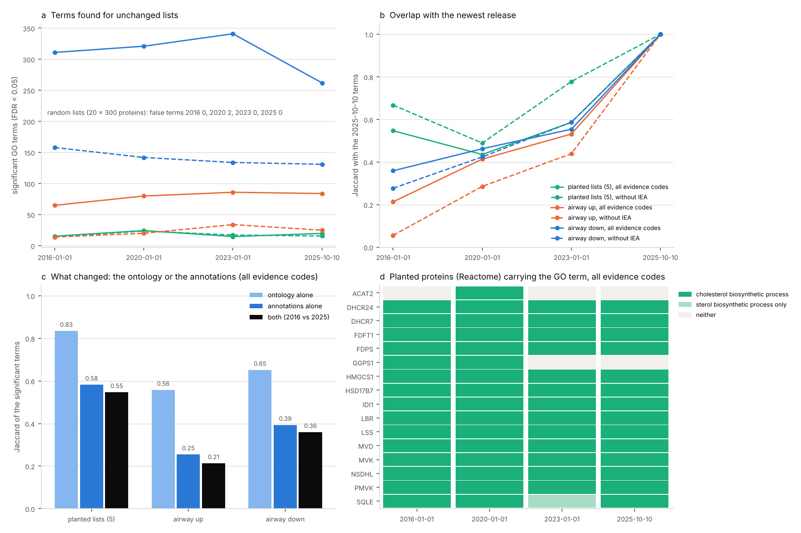

# The same gene lists, enriched with GO releases years apart (2026-11-04)

Tracking issue: [#19](https://github.com/shoo99/sbmlab-benchmarks/issues/19). Post: [Same gene list, different GO enrichment](https://sbmlab.com/blog/go-enrichment-gene-ontology-release-version-changes-results) ([한국어](https://sbmlab.com/blog/go-enrichment-gene-ontology-release-version-changes-results-ko)).

Wadi et al. (2016, *Nature Methods*) warned that outdated annotations change enrichment results. How much do they change for gene lists that stay exactly the same? Unchanged lists were run through the same over-representation analysis (ORA) against four Gene Ontology releases, from January 2016 to October 2025, with the identifiers and each list's universe held fixed. The background is the part of that universe annotated in each release, so its size and the number of tested terms change a little from release to release (Method, step 5).

- **Planted answers survive.** Each planted list holds 15 cholesterol-biosynthesis proteins among 300. "Cholesterol biosynthetic process" was found in all 5 lists in every release and under both evidence settings, at rank 1–5.
- **Random lists stay clean.** The 20 random lists gave no terms, except one list in the 2020 release, which gave 2 DNA-replication terms at FDR 0.024–0.027. They were not significant in 2016, 2023 or 2025.
- **The real list drifts a lot.** The dexamethasone-up list from the airway data set has a Jaccard overlap of only 0.21 between its 2016 and 2025 significant terms: 26 shared, out of 65 and 84. Of the 65 terms of 2016, 26 (40%) are still significant in 2025. Without electronic annotations the overlap is 0.06 (2 shared, out of 14 and 25). The down list has a Jaccard overlap of 0.36. These overlaps are for one list at one cutoff (FDR < 0.05). Part of the change is terms crossing the cutoff.
- **The expected biology depends on the release.** Dexamethasone is a glucocorticoid. "Response to glucocorticoid" is significant for the up list from 2020 on (FDR 0.005–0.027). It is not significant in 2016 (FDR 0.21, rank 285).
  - The hybrid run moves it only to FDR 0.19, so the 2016 annotations, not the 2016 ontology, are what miss it.
  - Without electronic (IEA) annotations it is never found (FDR 0.86–1.0).
- **Annotations moved more than the ontology** (all evidence codes).
  - Reading the 2016 annotations through the 2025 ontology gives a Jaccard overlap of 0.56–0.83 with the 2016 significant terms.
  - Changing the annotations at a fixed ontology gives 0.25–0.58.
  - This holds for the significant terms. Per protein, the two steps change about equally (mean Jaccard 0.63 for 2016 → hybrid, 0.61 for hybrid → 2025), so the claim is about what reaches the results, not about the annotation files as a whole.
  - Almost every protein's term set changed. Only 16 of 5,569 detected proteins have the same propagated term set in 2016 and 2025. The mean per-protein Jaccard is 0.42.
- **Even the planted genes move in and out.** Of the 16 detected Reactome cholesterol-biosynthesis proteins, 13–16 carry the GO term, depending on the release (all evidence codes; 11–16 without IEA).
  - ACAT2 has it only in 2020.
  - GGPS1 loses it after 2020.
  - SQLE has only "sterol biosynthetic process" in 2023.

## Data

| Input | Content |
|---|---|
| GO releases | `go-basic.obo` and `goa_human.gaf.gz` of 2016-01-01 (ontology data-version 2015-12-22, GAF 2.0), 2020-01-01 (GAF 2.1), 2023-01-01 and 2025-10-10 (GAF 2.2), from the GO release archive on AWS S3 (`go-data-product-release`) |
| Detected proteome | the 5,661 human protein groups DIA-NN 2.3.2 detected in the HYE run (`../diann-hye/report.pg_matrix.tsv`), each by its leading UniProt accession |
| Planted genes | Reactome "Cholesterol biosynthesis" (R-HSA-191273), 25 genes as in MSigDB 7.5.1 (`reactome_cholesterol.tsv`, taken from the msigdbr 7.5.1 package); 16 are detected |
| Real DE list | Bioconductor `airway` (Himes et al. 2014, GSE52778): four airway smooth-muscle cell lines, dexamethasone vs untreated. `airway_de.R` runs DESeq2 with the paired design `~ cell + condition`, as in `../deseq2-edger-limma-airway`. 511 genes go up and 489 down (padj < 0.05, \|log2FC\| ≥ 1) among 16,596 tested |
| Gene → protein | HGNC complete set, monthly archive of 2025-10-07: Ensembl gene id → UniProt accessions (13,195 of the tested genes have one) |

- **Why not 2026**: the 2026 releases are listed in the S3 bucket but their files return HTTP 403. `release.geneontology.org` was not reachable from the cloud environment. 2025-10-10 is the newest release that could be read.
- **Downloads**: `download.sh` fetches all of the above except the proteome and the gene set, which are in the repository. It checks `md5sums.txt`. None of the downloads are tracked.

## Lists

All lists were fixed before any release was read.

| Lists | Members | Background | Expected |
|---|---|---|---|
| `random_1..20` | 300 detected proteins drawn at random (seeds 1–20) | detected proteome | no term |
| `planted_1..5` | 15 detected cholesterol-biosynthesis proteins + 285 other detected proteins (seeds 101–105) | detected proteome | "cholesterol biosynthetic process" (GO:0006695) |
| `airway_up`, `airway_down` | dexamethasone up (443 with a UniProt accession) or down (435) | 13,195 tested genes | no fixed answer; "response to glucocorticoid" (GO:0051384) is the expected biology of the up list |

## Method

`enrich.py` (standard library; `go_ora.py` holds the readers and tests) does the following for each release:

1. **Annotations**: GAF rows for human UniProtKB entries, without NOT qualifiers. Isoform suffixes are dropped and alternative GO ids are mapped to their primary id. Terms that are obsolete in that release are dropped.
2. **Propagation**: each annotation is propagated to all ancestors over `is_a` and `part_of` in that release's `go-basic.obo`.
3. **Evidence settings**: two, all evidence codes and all but IEA (inferred from electronic annotation).
4. **Identifiers**: proteins are matched by UniProt accession. A gene carries a term if any of its accessions does.
5. **Background**: the list's universe (detected proteome or tested genes), restricted to members with at least one annotation in that release, as most ORA tools do. The list is restricted to the same members.
6. **Test**: a one-sided hypergeometric test for every term with 10–500 annotated background members, all three GO aspects together. Benjamini-Hochberg runs over the tested terms, and a term is significant at FDR < 0.05.
7. **Hybrid run**: reads the 2016 annotations through the 2025 ontology. Ids are mapped by the 2025 alternative ids, and terms obsolete by 2025 are dropped. 2016 → hybrid is then the change of ontology alone, and hybrid → 2025 the change of annotations alone.
   - The split runs in one order only (ontology first) and the two parts do not add up to the total.
   - Obsolete terms are not followed through `replaced_by`. A 2016 annotation that curators later moved to the replacement term is therefore counted under the annotation change.

GSEA was not run. The issue asked for it "where applicable", and only the airway list has a ranking.

## Scoring

`score.py` reads the tables in `results/` (standard library).

| Metric | Meaning |
|---|---|
| `false_terms`, `lists_with_false_terms` | significant terms over the 20 random lists (truth: 0) |
| `planted_recovery`, `planted_median_rank` | share of planted lists with GO:0006695 at FDR < 0.05, and its median rank by p-value |
| `terms_found` | significant terms (planted: mean of 5 lists) |
| `genes_annotated` | detected Reactome cholesterol-biosynthesis proteins that carry GO:0006695 (of 16) |
| `fdr: …`, `rank: …` | of "response to glucocorticoid" and "cellular response to glucocorticoid stimulus" in the airway up list |
| `jaccard_vs_2025`, `jaccard_vs_previous` | Jaccard overlap of the significant terms with the 2025-10-10 release, or with the previous release. Renamed or merged terms are compared by their 2025 id; terms obsolete by 2025 count as lost |
| `terms_obsolete_by_2025` | significant terms that no longer exist in 2025 |
| `jaccard_vs_2016` (hybrid) | overlap of the hybrid with 2016: what the ontology change alone keeps |
| `annotated`, `mean_terms_per_member`, `terms_tested` | the background per release |
| `proteins_gained`, `proteins_lost` | detected proteins annotated in only the later or only the earlier release |
| `unchanged_share`, `mean_protein_jaccard` | detected proteins with the same propagated term set, and the mean Jaccard of their term sets |
| `mean_term_jaccard` | mean Jaccard of the member sets of terms tested in both releases |

## How to run

```bash
bash download.sh
```

```bash
Rscript airway_de.R
```

```bash
python3 enrich.py && python3 score.py > score.out && python3 figure.py
```

- **Inputs**: `airway_de.R` needs DESeq2 (1.42.0 here), and `airway_de.tsv.gz` is tracked. `enrich.py` takes under a minute.
- **CI**: re-runs `score.py` from the bundled `results/` and compares `scores.csv` and `score.out` byte for byte. It also runs `figure.py` and `test/test_go_ora.py`. The test checks the OBO and GAF readers, propagation, the hypergeometric tail against exact sums, and Benjamini-Hochberg against hand-computed values.

## Results



**All evidence codes**:

| Release | False terms, 20 random lists | Planted found | Median rank | Cholesterol proteins with the term | Airway up | Airway down | "Response to glucocorticoid", FDR (rank) |
|---|---|---|---|---|---|---|---|
| 2016-01-01 | 0 | 5/5 | 1 | 15/16 | 65 | 311 | 0.207 (285) |
| 2020-01-01 | 2 (1 list) | 5/5 | 1 | 16/16 | 80 | 321 | 0.005 (16) |
| 2023-01-01 | 0 | 5/5 | 2 | 13/16 | 86 | 341 | 0.027 (66) |
| 2025-10-10 | 0 | 5/5 | 5 | 14/16 | 84 | 262 | 0.025 (49) |

**Overlap of the significant terms with 2025-10-10** (Jaccard; planted is the mean of 5 lists):

| Release | Planted | Airway up | Airway down | Airway up, no IEA | Airway down, no IEA |
|---|---|---|---|---|---|
| 2016-01-01 | 0.55 | 0.21 | 0.36 | 0.06 | 0.28 |
| 2020-01-01 | 0.44 | 0.41 | 0.46 | 0.29 | 0.42 |
| 2023-01-01 | 0.59 | 0.53 | 0.55 | 0.44 | 0.59 |

**Ontology or annotations** (all evidence codes; Jaccard of the significant terms):

| List | 2016 vs hybrid (ontology alone) | Hybrid vs 2025 (annotations alone) | 2016 vs 2025 (both) |
|---|---|---|---|
| Planted | 0.83 | 0.58 | 0.55 |
| Airway up | 0.56 | 0.25 | 0.21 |
| Airway down | 0.65 | 0.39 | 0.36 |

**The detected proteome, release to release** (all evidence codes):

| Releases | Proteins gained / lost | Same term set | Mean protein Jaccard | Mean term Jaccard |
|---|---|---|---|---|
| 2016 → 2020 | 47 / 14 | 0.8% | 0.60 | 0.66 |
| 2020 → 2023 | 24 / 3 | 2.8% | 0.74 | 0.75 |
| 2023 → 2025 | 18 / 0 | 2.0% | 0.73 | 0.80 |
| 2016 → 2025 | 73 / 1 | 0.3% | 0.42 | 0.51 |

`score.out` also has the settings without IEA and the hybrid-run detail.

## Traps

- **Report the GO release, not just the tool version.** The same tool on the same list gives a different answer with each release. Here 65 vs 84 terms for the up list, with only 26 in common.
- **Electronic annotations carry some of the expected biology.** Without IEA, "response to glucocorticoid" is never significant for dexamethasone-induced genes. In the 2025 release, 99 of the 139 human proteins annotated to it (or to a descendant) have it only through IEA. Most of those rows (117 of 123 IEA rows) cite GO_REF:0000107: experimental annotations of orthologs in other species, transferred by Ensembl Compara. These counts are not in `results/`; they come from `read_obo` and `read_gaf` in `go_ora.py` run on the 2025-10-10 files.
  - The no-IEA result rests on small terms: GO:0051384 has 11–20 annotated genes in the background without IEA, of which 1–2 are in the list. Dropping IEA is not automatically the stricter choice.
- **Term counts hide turnover.** The airway down list gives 311 terms in 2016 and 262 in 2025, but only 36% of them are shared. Seventeen of the 2016 terms no longer exist, for example "cellular divalent inorganic cation homeostasis".
- **Identifiers have to be held fixed on purpose.** Here proteins are UniProt accessions and genes are mapped through one HGNC table. Matching by gene symbol would add symbol renames to the drift. The HGNC table is from 2025, so a UniProt accession that was merged after 2016 can lose some of its 2016 annotations.
- **A planted answer is not a guarantee.** The planted genes come from Reactome, not GO. Three of them lost the GO term between 2020 and 2023. The term was still found because the other 12–13 in each list kept it.

## Files

| File | Content |
|---|---|
| `download.sh`, `md5sums.txt` | GO releases, HGNC table and airway data, with checksums |
| `reactome_cholesterol.tsv` | the planted gene set (Reactome R-HSA-191273 in MSigDB 7.5.1) |
| `airway_de.R`, `airway_de.tsv.gz` | the real DE list (DESeq2, paired design) |
| `go_ora.py`, `enrich.py` | OBO/GAF readers and ORA; the lists against every release |
| `results/` | significant terms, list sizes, tracked terms, background annotation, release-to-release changes, the planted proteins' terms |
| `score.py`, `score.out`, `scores.csv` | scoring from `results/` (standard library) |
| `figure.py`, `go_release_drift.png` | the figure |
| `test/test_go_ora.py` | known-answer tests for `go_ora.py` |
