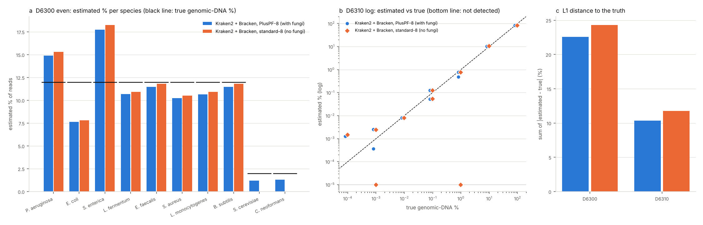

# Metagenomic taxonomic profilers on ZymoBIOMICS mock communities (2026-11-04)

Tracking issue: [#15](https://github.com/shoo99/sbmlab-benchmarks/issues/15). No post yet.

Which profiler recovers a known community best, and how much does the reference database decide the answer? Two ZymoBIOMICS mock communities with known composition were profiled with Kraken2 + Bracken against two capped databases. One database contains fungi and the other does not. MetaPhlAn 4, mOTUs and sylph are set up as workstation steps; their databases could not be fetched in the cloud environment.

- **The database decides what can be found.** The mock contains two yeasts at 2% each. Kraken2's standard database has no fungi, so it cannot report them: recall is 8 of 10 species. The PlusPF database has fungi and finds both, at 1.2% and 1.3%.
- **Taxonomy renaming can double the error.** Zymo's *Bacillus subtilis* strain (NRRL B-354, = ATCC 6633) is now *Bacillus spizizenii* in NCBI taxonomy, and Kraken2 reports 11.1% of the reads under that name. Matched by the product-sheet name alone, the L1 distance is 44.8 instead of 22.6.
- **Close relatives trade reads.** *E. coli* comes out at 7.6% (truth 12%) and *Salmonella enterica* at 17.7% (12%). Another 0.4% of all reads go to *Shigella flexneri*, a close relative of *E. coli*. In the log-distribution mock, 2.6% of the reads go to *Listeria innocua* instead of *L. monocytogenes*.
- **"Detected" depends on a threshold.** Bracken reports about 240 species with at least 10 reads, but only 10 are in the mock.

  | Threshold | Precision (D6300, PlusPF) |
  |---|---|
  | any reported species | 0.04 |
  | ≥ 0.01 % | 0.34 |
  | ≥ 0.1 % | 0.71 |

  Every mock species stays above 0.1%.
- **Low abundances are found but overestimated.** In the log mock, every species down to *Staphylococcus aureus* at 0.000089% gets reads. *C. neoformans* is found only with PlusPF. Below 0.001%, though, the estimates are 3–13 times too high: *E. faecalis* 0.0025% (truth 0.00089%), *S. aureus* 0.0012% (truth 0.000089%). Misassigned reads from abundant species are a likely cause.

## Data

| Mock | Composition | Run | Reads |
|---|---|---|---|
| ZymoBIOMICS D6300 (even) | 8 bacteria at 12% each, 2 yeasts at 2% each (genomic DNA) | ERR2984773 (Nicholls et al. 2019, *GigaScience*), Illumina MiSeq 2×151 | 8.8 M pairs |
| ZymoBIOMICS D6310 (log distribution) | *Listeria monocytogenes* 89.1%, *Pseudomonas aeruginosa* 8.9%, ... down to *Staphylococcus aureus* 0.000089% | ERR2935805, Illumina HiSeq 1500 2×101 | 47.8 M pairs |

- **Truth** (`truth.tsv`): the theoretical genomic-DNA composition.
  - D6300 is from the Zymo product sheet (Table 1).
  - D6310 is from the Zymo D6310 sheet, as tabulated in LomanLab/mockcommunity `metadata/staggered.txt`.
  - Read-based profilers estimate DNA (read) fractions, so this is the composition they should report. It is not the cell or genome-copy composition.
- **Downloads**: `download.sh` fetches both runs from NCBI SRA's AWS open-data mirror (`s3://sra-pub-run-odp`; md5 `7175dc3b10183b32d1e2f46a1dcdacd9` and `6385ccd96207be157ec781cb630a87cf`) and the Kraken2 databases from `genome-idx.s3.amazonaws.com`. None of these are tracked.
- **Full depth**: both mates of every pair are classified as single reads, at full depth, streamed out of the `.sra` files with `fastq-dump`.

## Profilers and databases

| Profile | Version | Database |
|---|---|---|
| Kraken2 + Bracken, standard-8 (no fungi) | Kraken2 2.17.2, Bracken 3.0.1 | `k2_standard_08gb_20240904`: archaea, bacteria, viruses, plasmids, human, UniVec_Core, capped at 8 GB (hash.k2d md5 `66898902db611477e3c415876f4be6ea`) |
| Kraken2 + Bracken, PlusPF-8 (with fungi) | the same | `k2_pluspf_08gb_20240904`: standard plus protozoa and fungi, capped at 8 GB (md5 `c101ec9642fd7a7cd0867129c1f3ced0`) |
| MetaPhlAn 4, mOTUs 3, sylph (GTDB r220) | workstation | their databases (about 20 GB, 3.5 GB and 14 GB) were not reachable or not practical in the cloud environment |
| Kraken2 + Bracken, uncapped standard | workstation | about 80 GB on disk and in RAM (`DB_FULL=1 bash download.sh`) |

- **Bracken settings**: species level (`-l S`), at least 10 reads (`-t 10`), read length 150 (D6300) or 100 (D6310).
- **Profiles**: percentages come from Bracken's `new_est_reads` over all species. Its `fraction_total_reads` column is rounded to 5 decimals, which is too coarse below 0.001%.
- **The CAMI2 data sets** are not included yet. Their host was not reachable either.

## Scoring

`score.py` uses the standard library only. It matches species by NCBI taxid, or by name for profilers that report names.

| Metric | Meaning |
|---|---|
| `l1_distance` | sum over all species of \|estimated % − true %\| (0 = perfect, 200 = disjoint); species outside the mock count in full |
| `l1_distance_strict` | the same, but with *Bacillus spizizenii* counted as a false positive (product-sheet names only) |
| `bray_curtis` | L1 / 200 |
| `precision`, `recall` | species called present at any reported abundance, at ≥ 0.01 % and at ≥ 0.1 % |
| `false_positive_species` | species reported that are not in the mock |
| `detection_limit_percent` | (D6310) the lowest true abundance among the mock species that got reads |
| `estimated_percent` | per mock species |
| `classified_share` | reads classified at any rank |

## How to run

```bash
bash download.sh
```

```bash
MG_BIN=/path/to/env/bin bash run.sh kraken
```

```bash
python3 score.py > score.out && python3 figure.py
```

- **Environment**: the one from `micromamba create -c conda-forge -c bioconda kraken2 bracken sra-tools`.
- **What `run.sh kraken` does**: it runs every database under `db/` on both mock communities. It writes `results/<mock>_<db>.kreport` and `.bracken`, and it records wall time, CPU time and peak memory in `timings.tsv`.
- **Workstation profilers**: `run.sh metaphlan | motus | sylph` runs them with their own databases (`METAPHLAN_DB`, `MOTUS_DB`, `SYLPH_DB`). Each writes `results/<mock>_<tool>.profile.tsv`, which `score.py` picks up.
- **Downloads in the cloud environment**: a streamed database download was cut off by a connection reset. Fetching the archives in byte-range chunks and feeding them into `tar` fixed it.
- **CI** re-runs `score.py` from the bundled Kraken2 and Bracken outputs and compares `scores.csv` and `score.out` byte for byte. It also runs `figure.py`.

## Results



**D6300 (even)**:

| Profile | L1 | L1, strict names | Recall | Precision ≥ 0.1 % | Classified |
|---|---|---|---|---|---|
| Kraken2 + Bracken, PlusPF-8 | 22.6 | 44.8 | 10/10 | 0.71 | 79.4% |
| Kraken2 + Bracken, standard-8 | 24.3 | 47.1 | 8/10 | 0.67 | 80.2% |

**D6310 (log)**:

| Profile | L1 | Recall, any reads | Recall ≥ 0.01 % | Classified |
|---|---|---|---|---|
| Kraken2 + Bracken, PlusPF-8 | 10.3 | 10/10 | 6/10 | 52.4% |
| Kraken2 + Bracken, standard-8 | 11.8 | 8/10 | 5/10 | 56.1% |

`score.out` has the estimate for every species.

**Run time** (4 threads, reads streamed from `.sra`): 47–52 s for D6300 (17.6 M reads) and 178 s for D6310 (95.7 M reads). Peak memory is 7.9–8.3 GB, the size of the database.

## Traps

- **Use current taxonomy names, or record the strain.** The *Bacillus* strain of the Zymo standards has been renamed *B. spizizenii*. A scorer that looks only for "Bacillus subtilis" sees the mock's *Bacillus* as missing and a false positive at 11%.
- **A database without fungi is silent about fungi.** It does not report them as unknown; their reads go unclassified or to other taxa.
- **Precision depends on the threshold.** With Bracken's default of 10 reads, hundreds of species appear in a 10-species mock. Report the threshold with any precision figure.
- **Low abundances are biased upward.** At 0.001% and below, the estimate is dominated by misassigned reads, not by the species itself.
- **Unexplained in this run**:
  - *Xanthomonas euvesicatoria* at 1.2% (D6300) and 0.5% (D6310). It is not in the mock. It could be a contaminant or a misassignment; this was not resolved.
  - Only 52–56% of D6310 reads are classified, against 80% for D6300.

## Files

| File | Content |
|---|---|
| `truth.tsv` | theoretical genomic-DNA composition of D6300 and D6310 |
| `download.sh` | fetches the runs and the Kraken2 databases |
| `run.sh` | Kraken2 + Bracken, plus workstation steps for MetaPhlAn 4, mOTUs and sylph |
| `results/` | Kraken2 reports and Bracken species tables |
| `timings.tsv` | run time and memory |
| `score.py`, `score.out`, `scores.csv` | scoring from the bundled tables (standard library) |
| `figure.py`, `metagenome_profilers_mock.png` | the figure |
