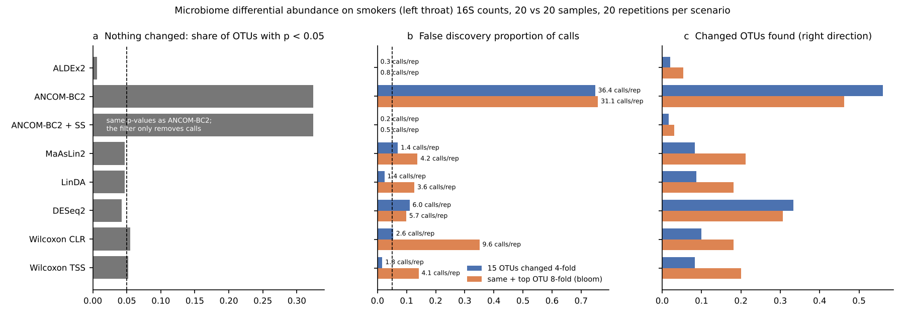

# Microbiome differential abundance methods scored on planted changes (2026-11-03)

Tracking issue: [#18](https://github.com/shoo99/sbmlab-benchmarks/issues/18). No post yet.

Nearing et al. (2022, *Nat Commun* 13:342) found that differential abundance (DA) methods disagree widely on the same microbiome data. Here the answer is known: real 16S counts, split at random, with changes planted on the absolute scale.

- **Nothing changed.** ANCOM-BC2's q-values call 23.5 OTUs per repetition, all false, and 32% of OTUs have p < 0.05. Its own sensitivity filter removes every one of those calls, along with almost every true call later on.
- **Nothing changed, other methods.** MaAsLin2, LinDA, DESeq2 and both Wilcoxon tests have well-calibrated p-values (4.2–5.5% below 0.05). ALDEx2 is very conservative (0.6%).
- **Changes planted.** No method finds many changes at this depth and sample size: 15 OTUs changed 4-fold, about 2,000 reads per sample, 20 vs 20.
  - DESeq2 finds the most (33%) at an FDP of 0.11.
  - The others find 2–10%.
- **A dominant OTU blooms.** All other OTUs are pushed down in relative terms. Wilcoxon on CLR then makes 6.7 false calls per repetition (FDP 0.35). MaAsLin2, LinDA and Wilcoxon on relative abundance rise to FDP 0.13–0.14. None of the methods that make calls stays at 0.05.

## Data

The template is the `smokers` data shipped with the R package MicrobiomeStat 1.4: 16S OTU counts from the upper respiratory tract of smokers and non-smokers (Charlson et al. 2010).
- We use the left-throat samples, one per subject, and keep the 68 with at least 1,000 reads (median about 2,000).
- We keep the 222 OTUs present in at least 10% of those samples.
- The data are loaded from the package and are not copied here.

## Truth

Each repetition draws 40 of the 68 samples and splits them 20 / 20 at random. Changes are then planted on the counts of group B, on the absolute scale:

| Scenario | What changes in group B | Unchanged OTUs |
|---|---|---|
| null | nothing | all (every call is false) |
| planted | 15 OTUs present in ≥ 50% of the template, 4-fold up or down at random | the rest |
| bloom | as planted, plus the most abundant OTU (12.4% of reads) 8-fold up | the rest, though their *relative* abundance drops because of the bloom |

- Every sample in both groups is then redrawn to its own depth with a multinomial, so the data stay compositional.
- OTUs present in fewer than 4 of the 40 samples are dropped, the same for every method.
- A call is correct only for a changed OTU and in the right direction, judged by each method's own effect estimate. Scoring uses `common/known_ratio.R`.
- 20 repetitions per scenario, with fixed seeds.

## Tools

All tools run in a conda environment pinned in `conda-linux-64.lock` (392 packages). `environment.yml` lists the main versions: R 4.5.3, ALDEx2 1.42.0, ANCOMBC 2.14.0, Maaslin2 1.22.0, MicrobiomeStat 1.4 and DESeq2 1.50.2. These packages are not in Ubuntu's archive, so the environment comes from conda-forge and bioconda.

| Method | Settings | Call |
|---|---|---|
| ALDEx2 | `aldex(test = "t", mc.samples = 128, denom = "all", effect = TRUE)` | Welch BH < 0.05 |
| ANCOM-BC2 | `ancombc2(fix_formula = "group", p_adj_method = "BH")` (package default is Holm) | q < 0.05 (`diff`) |
| ANCOM-BC2 + SS | same run | q < 0.05 and passed the pseudo-count sensitivity check (`diff_robust`) |
| MaAsLin2 | TSS normalisation, LOG transform, LM | q < 0.05 (package default is 0.25) |
| LinDA | `linda(feature.dat.type = "count")` | padj < 0.05 |
| DESeq2 | `poscounts` size factors, Wald | padj < 0.05 |
| Wilcoxon CLR | centred log-ratio with pseudo-count 0.5, rank-sum test | BH < 0.05 |
| Wilcoxon TSS | relative abundance, rank-sum test | BH < 0.05 |

## How to run

```bash
micromamba create -p ./env --file conda-linux-64.lock
```

```bash
OPENBLAS_NUM_THREADS=1 ./env/bin/Rscript da_study.R > da_study.out
```

```bash
python3 figure.py
```

`da_study.R` takes about 13 minutes on 4 cores (`DA_CORES`, default 4) and writes `scores.csv`. Each repetition sets its own seed, so the result does not depend on the number of cores. `figure.py` draws `microbiome_da_methods.png` from `scores.csv`.

CI (job `microbiome`) builds the same environment from the lock file and re-runs `da_study.R` with `ci/reproduce.sh microbiome`, comparing the printout and `scores.csv` with the bundled files.

## Results



**Nothing changed** (means over 20 repetitions, 187 OTUs tested each):

| Method | Share of OTUs with p < 0.05 (expected 0.05) | False calls per repetition | Repetitions with any call (should be ≤ 0.05) |
|---|---|---|---|
| ALDEx2 | 0.006 | 0 | 0 |
| ANCOM-BC2 | 0.324 | 23.5 | 1.00 |
| ANCOM-BC2 + SS | 0.324 (same p-values) | 0 | 0 |
| MaAsLin2 | 0.047 | 0.05 | 0.05 |
| LinDA | 0.047 | 0.15 | 0.10 |
| DESeq2 | 0.042 | 0.50 | 0.30 |
| Wilcoxon CLR | 0.055 | 0 | 0 |
| Wilcoxon TSS | 0.052 | 0.05 | 0.05 |

**Planted and bloom.** Power is the share of changed OTUs called in the right direction. FDP is (false + wrong-direction calls) / calls, with a target of 0.05. Calls are per repetition. Each cell reads power / FDP / calls.

| Method | Planted | Bloom |
|---|---|---|
| ALDEx2 | 0.020 / 0 / 0.3 | 0.053 / 0 / 0.85 |
| ANCOM-BC2 | 0.560 / 0.748 / 36.4 | 0.462 / 0.758 / 31.1 |
| ANCOM-BC2 + SS | 0.017 / 0 / 0.25 | 0.031 / 0 / 0.5 |
| MaAsLin2 | 0.083 / 0.070 / 1.4 | 0.212 / 0.138 / 4.25 |
| LinDA | 0.087 / 0.024 / 1.4 | 0.181 / 0.127 / 3.65 |
| DESeq2 | 0.333 / 0.110 / 6.05 | 0.306 / 0.099 / 5.65 |
| Wilcoxon CLR | 0.100 / 0.054 / 2.6 | 0.181 / 0.351 / 9.6 |
| Wilcoxon TSS | 0.083 / 0.017 / 1.3 | 0.200 / 0.141 / 4.1 |

All numbers are in `da_study.out` and `scores.csv`.

What the numbers say:

- **ANCOM-BC2's q-values are not usable on their own here.** Under the null, a third of OTUs have p < 0.05.
  - The calls come from sparse OTUs. In a diagnostic null split, OTU t1 had two non-zero counts in each group of 20 (9 and 1 vs 7 and 133), yet ANCOM-BC2 estimated a log fold change of 1.94 with a standard error of 0.22.
  - The package's pseudo-count sensitivity check (`diff_robust`) catches these, but it also removes nearly all true changes: power 0.02–0.03.
- **ALDEx2 is safe but nearly blind** at this depth: no false calls, and 2–5% of the changes found.
- **DESeq2 has the most usable power**, at about twice the target FDP. It made at least one false call in 30% of the null repetitions.
- **MaAsLin2 and LinDA are close to their targets without a bloom**, but they find under 10% of the changes.
- **A bloom breaks the relative-abundance and CLR approaches.** With one OTU rising 8-fold, every other OTU loses about half its share, and some of those losses are called as decreases. Wilcoxon on CLR suffers most: its FDP goes from 0.05 to 0.35. Power rises for several methods in the bloom scenario. Likely reasons, not checked separately: the bloomed OTU is easy to find, and the compositional shift exaggerates the planted decreases.
- **Agreement between methods** (the issue's third score) is not informative here: most methods make one to six calls per repetition. The visible disagreement is ANCOM-BC2's raw calls against everyone else.

## Traps

- **ANCOMBC 2.14** reorders `meta_data` with `meta_data[samples, ]`. With a single metadata column this turns the data frame into a vector and stops with "The following variables specified are not in the meta data". `da_study.R` adds a sample-ID column to keep two columns.
- **Defaults that change the result**: ANCOM-BC2 adjusts with Holm by default and MaAsLin2 reports q < 0.25 as significant. Both are set to the common BH < 0.05 here, and the table says so.
- **MaAsLin2 writes output files and plots by default.** `da_study.R` sends them to a temporary directory and turns plots off.
- **Uncertainty.** Each scenario has 20 repetitions, and FDP from 1–2 calls per repetition (MaAsLin2, LinDA, Wilcoxon TSS without a bloom) is noisy. The figure prints the calls per repetition next to each FDP bar.

## Not included

The smokers data, which are loaded from MicrobiomeStat, and the conda environment, which is built from `conda-linux-64.lock`.
