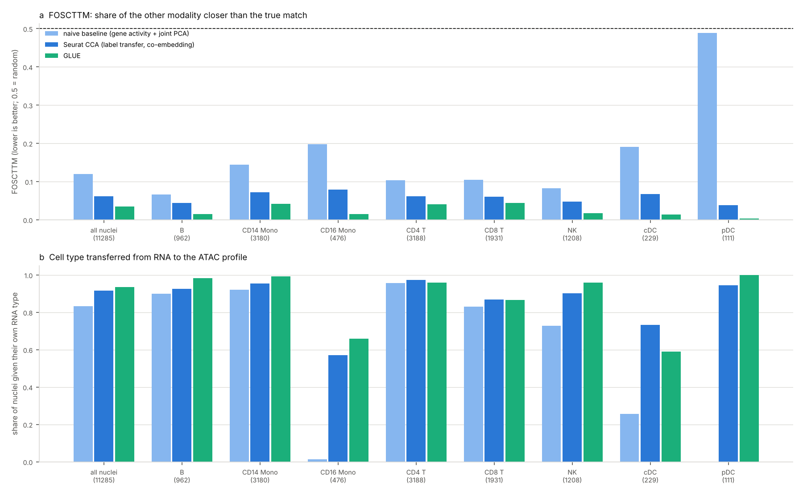

# Unpaired RNA + ATAC integration scored with 10x Multiome pairing (2026-11-04)

Tracking issue: [#16](https://github.com/shoo99/sbmlab-benchmarks/issues/16). No post yet.

Methods that integrate single-cell RNA and ATAC from different cells are usually judged by how well the cell types mix. A 10x Multiome run measures both modalities in the same nuclei, so the right answer is known for every ATAC profile: it is the RNA profile with the same barcode. Here the pairing is hidden from each method and used only to score it.

Three methods were scored: a naive gene-activity baseline, Seurat's CCA label transfer, and GLUE. LIGER could not be installed in the cloud environment.

- **GLUE pairs the modalities best.** FOSCTTM (0 = every true match is the nearest; 0.5 = random) is 0.035 for GLUE, 0.062 for Seurat CCA and 0.119 for the naive baseline.
- **The exact nucleus is still rarely the nearest.** GLUE puts the ATAC profile's own RNA profile first for 1.9% of nuclei, and within the nearest 1% for 43%. Seurat gets 0.4% and 26%. The integrations recover the cell state far more often than the exact nucleus. The "nearest" shares may be up to about 2× too low (see *Known issue* below).
- **Label transfer is close between Seurat and GLUE.** Accuracy is 0.916 for Seurat and 0.935 for GLUE. Balanced over cell types, it is 0.859 and 0.876.
- **Overall accuracy hides the rare types.**
  - The naive baseline reaches 0.832 overall while labelling 0 of 111 pDCs and 6 of 476 CD16 monocytes correctly. Its balanced accuracy is 0.576.
  - GLUE gives only 59% of cDCs their type, against 73% for Seurat: 40% are taken for CD14 monocytes. For CD16 monocytes GLUE does better (66% vs 57%).
  - These per-type numbers compare classifiers as well as embeddings. GLUE labels by a 15-cell majority vote, which pulls a rare type towards a large neighbour, while Seurat uses `TransferData`. GLUE places the cDCs well (FOSCTTM 0.014, its second best type). The gap comes from one seed and was not checked over several.
- **Most errors stay within a lineage.** For GLUE, 79% of the label errors stay within a lineage, for example CD8 T taken for CD4 T or NK. The share is 67% for Seurat and 64% for the baseline. The lineage map decides this ranking: with cDCs grouped with the monocytes as myeloid, the shares are 92% for GLUE and 71% for both Seurat and the baseline.

## Data

- **Run**: 10x Genomics "PBMC from a healthy donor, granulocytes removed through cell sorting (10k)", Cell Ranger ARC 2.0.0 filtered feature-barcode matrix (`pbmc10k_multiome.h5`, md5 `df86844b99161b9487090d91e644745e`). It has 11,898 barcodes, 36,601 genes and 143,887 ATAC peaks.
- **Gene coordinates**: iGenomes UCSC hg38 `genes.gtf` (md5 `61535b7d94cdff8994d514e3b393cfe3`). Only transcripts that overlap the 10x gene's TSS interval are kept, so duplicated gene names do not create megabase spans.
- **Cells**: 11,310 pass the filters: RNA 1,000–25,000 counts, at least 500 genes, mitochondrial share < 20%, and ATAC 1,000–100,000 peak counts. 25 cells in an unassigned cluster are dropped, leaving **11,285**. QC uses both modalities, so both sides hold exactly the same nuclei, one to one. That is easier than real unpaired data, where some cells of one modality have no counterpart in the other.
- **Downloads**: `download.sh` fetches both files. They are not tracked.

## Cell-type truth

The RNA side defines the labels. Each modality's own cells are never relabelled from the other.

- **Clustering**: log-normalised counts, 2,000 variable genes, 30 PCs, Louvain clusters at resolution 0.8.
- **Labels**: each cluster gets the type whose marker set has the highest mean scaled expression. A cluster whose best score is below 0.15 is left unassigned.

| Type | Markers | Nuclei |
|---|---|---|
| CD14 monocytes | CD14, LYZ, S100A8, VCAN | 3,180 |
| CD16 monocytes | FCGR3A, MS4A7, CDKN1C | 476 |
| cDC | FCER1A, CD1C, CLEC10A | 229 |
| pDC | LILRA4, IL3RA, CLEC4C | 111 |
| B | MS4A1, CD79A, BANK1, PAX5 | 962 |
| CD4 T | CD3E, IL7R, CD4, CCR7 | 3,188 |
| CD8 T | CD3E, CD8A, CD8B | 1,931 |
| NK | NKG7, GNLY, KLRD1, PRF1 | 1,208 |

The per-cluster scores are in `seurat_methods.out`.

## Methods

| Method | Version | What it does |
|---|---|---|
| Naive baseline | R 4.3.3, irlba 2.3.5.1 | ATAC gene activity (peak counts in the gene body plus 2 kb upstream, strand-aware) and RNA on the shared variable genes, each z-scored within its modality; one PCA (30 PCs) of both |
| Seurat CCA | Seurat 5.0.1 | `FindTransferAnchors(reduction = "cca")` from RNA to gene activity; `TransferData` for labels, weighted by the ATAC LSI (TF-IDF + SVD of peaks, dims 2–30); co-embedding as in Seurat's ATAC vignette (RNA imputed for the ATAC cells, merged, one PCA) |
| GLUE | scglue 0.5.2, torch 2.14.1 (CPU) | the scglue tutorial: RNA counts with 2,000 Seurat-v3 variable genes and 100 PCs; ATAC LSI with 100 components; an RNA-anchored guidance graph from gene body + promoter to peaks; negative-binomial likelihoods; pretraining, then fine-tuning with the discriminator and balancing weights; random seed 0 |
| LIGER / UINMF | not run | `rliger` is not on conda, and CRAN is not reachable from the cloud environment |

- **Hidden pairing**: GLUE gets the ATAC cells under new names (`atac-0` …), so it cannot pair them by barcode. The R methods see the barcodes only as row names and never use them to match cells.
- **Labels**: every method transfers a type to each ATAC profile. Seurat uses `TransferData`. The baseline and GLUE use the majority of the 15 nearest RNA cells in their joint embedding. The nucleus's own RNA profile is in that reference and is one of the 15 voters for 14.7% of ATAC profiles with GLUE and 5.0% with the baseline. Real unpaired data would not have it, so this favours GLUE's label accuracy slightly.
- **Adding LIGER**: a run on a workstation can write `results/liger.tsv` in the same format (below), and `score.py` will pick it up.

## Scoring

Each `results/<method>.tsv` has one row per nucleus with these columns:
- `barcode`
- `true_type`: the RNA cell type
- `predicted_type`: the type transferred to its ATAC profile
- `foscttm_atac`: the share of RNA cells closer to the ATAC profile than its own RNA profile
- `foscttm_rna`: the reverse share

`score.py` (standard library) computes:

| Metric | Meaning |
|---|---|
| `foscttm` | fraction of samples closer than the true match, averaged over both directions (0 = every true match is the nearest; 0.5 = random) |
| `foscttm_atac_to_rna`, `foscttm_rna_to_atac` | each direction |
| `label_accuracy` | share of ATAC profiles given their own nucleus's RNA type |
| `errors_within_lineage` | share of the label errors that stay within a lineage (T/NK, B, monocytes, dendritic cells), e.g. CD4 T taken for CD8 T. cDCs and monocytes are separate lineages here, although both are myeloid |
| per cell type | label accuracy and FOSCTTM |

## How to run

```bash
bash download.sh
```

```bash
Rscript seurat_methods.R > seurat_methods.out
```

```bash
python run_glue.py
```

```bash
python3 score.py > score.out && python3 figure.py
```

- **R methods**: `seurat_methods.R` took 7.4 minutes (4 BLAS threads) with a peak of 10.1 GB of memory. The 15 GB container ran out of memory twice before the script was changed to free the full matrix early and compute the LSI in place. It also writes `work/cells.tsv` and `work/gene_coords.tsv` for GLUE.
- **GLUE**: `run_glue.py` runs in a Python 3.11 environment with `pip install scglue scikit-misc igraph leidenalg` and pynndescent 0.5.13. The bioconda scglue pins numpy < 1.22, which cannot run scglue's own Python 3.10+ code.
  - With pynndescent 0.7.0, the balancing step fails: scanpy 1.11.5 calls `getnnz`, which the returned sparse array no longer has.
  - Each training stage is saved under `work/glue`, and a rerun resumes from the last saved stage.
  - The run here was resumed once, after pretraining, when the balancing step failed. Pretraining does not use pynndescent, igraph or leidenalg, the packages that changed in between. `run_glue.out` has both parts.
  - Run time: about 80 minutes on 4 CPU threads, with a peak of 6.9 GB of memory. The first run logged 204 s of setup and 2,083 s of pretraining. The resumed run (setup, balancing and fine-tuning) took 2,533 s.
- **CI**: re-runs `score.py` from the bundled `results/` and compares `scores.csv` and `score.out` byte for byte. It also runs `figure.py`.

## Known issue: the self-distance

The bundled `results/` were made by a version of `foscttm()` in `seurat_methods.R` and `run_glue.py` that computed the true pair's distance separately from the full distance matrix. Rounding could make that separate value slightly larger than the same entry in the matrix, so the true match itself was counted as one "closer" cell. Too many nuclei have exactly 1 closer cell compared with 0 (GLUE 202 vs 216, Seurat 54 vs 40, baseline 68 vs 39), which fits this.

- **FOSCTTM**: changes by at most 1/(n − 1) per nucleus; the means move by less than 0.0001.
- **True match nearest**: the 0.3% / 0.4% / 1.9% may be up to about 2× too low.
- **Fix**: both scripts now take the true pair's distance from the same matrix. The results have not been regenerated yet (Seurat 7 minutes, GLUE about 80 minutes); this is tracked in issue #16.

## Results



**All 11,285 nuclei**:

| Method | FOSCTTM | ATAC → RNA | RNA → ATAC | True match nearest | True match in nearest 1% | Label accuracy | Balanced | Errors within lineage |
|---|---|---|---|---|---|---|---|---|
| Naive baseline | 0.119 | 0.127 | 0.111 | 0.3% | 19.1% | 0.832 | 0.576 | 64% |
| Seurat CCA | 0.062 | 0.080 | 0.044 | 0.4% | 25.5% | 0.916 | 0.859 | 67% |
| GLUE | 0.035 | 0.035 | 0.035 | 1.9% | 43.0% | 0.935 | 0.876 | 79% |

**Per cell type** (label accuracy / FOSCTTM):

| Type | Nuclei | Naive baseline | Seurat CCA | GLUE |
|---|---|---|---|---|
| CD14 monocytes | 3,180 | 0.920 / 0.144 | 0.954 / 0.072 | 0.993 / 0.042 |
| CD16 monocytes | 476 | 0.013 / 0.197 | 0.571 / 0.079 | 0.660 / 0.015 |
| cDC | 229 | 0.258 / 0.190 | 0.734 / 0.067 | 0.590 / 0.014 |
| pDC | 111 | 0.000 / 0.489 | 0.946 / 0.038 | 1.000 / 0.004 |
| B | 962 | 0.899 / 0.066 | 0.925 / 0.044 | 0.982 / 0.015 |
| CD4 T | 3,188 | 0.958 / 0.104 | 0.974 / 0.062 | 0.959 / 0.041 |
| CD8 T | 1,931 | 0.830 / 0.105 | 0.869 / 0.061 | 0.866 / 0.044 |
| NK | 1,208 | 0.729 / 0.082 | 0.902 / 0.047 | 0.960 / 0.018 |

**Run time** (4 CPU threads):
- **R methods**: preparation, cell types, the baseline and Seurat CCA together took 7.4 minutes, with a peak of 10.1 GB.
- **GLUE**: about 80 minutes in all, with a peak of 6.9 GB. Early stopping kept epoch 52 of pretraining and epoch 62 of fine-tuning.

## Traps

- **Report balanced or per-type accuracy.** The naive baseline gets 83% of all nuclei right while labelling no pDCs correctly. Large types (CD4 T, CD14 monocytes) carry the overall number.
- **Good mixing is not pairing.** GLUE transfers 93.5% of the labels correctly, yet the nearest RNA profile is the right nucleus for only 1.9% of ATAC profiles. Do not treat the nearest neighbour across modalities as the same cell, for example to link peaks to genes cell by cell.
- **Report FOSCTTM in both directions.** Seurat's co-embedding is asymmetric (0.080 ATAC → RNA vs 0.044 RNA → ATAC); GLUE's is not.
- **The label truth is itself an RNA clustering.** The CD4/CD8 T and CD14/CD16 monocyte boundaries are fuzzy in the RNA data too, so some "within-lineage errors" may be ambiguous cells rather than integration failures.
- **The GLUE stack is fragile.** The bioconda package cannot run. The pip package does not install the Leiden clustering it needs, and pynndescent 0.7.0 breaks its balancing step through scanpy. Pin the environment and record it. This `run_glue.out` records Python, scglue, torch, scanpy and numpy, and the packages changed for the resume. The other versions were not recorded; `run_glue.py` now prints them too.

## Files

| File | Content |
|---|---|
| `download.sh` | fetches the Multiome matrix and the gene annotation |
| `seurat_methods.R`, `seurat_methods.out` | cells, RNA cell types, gene activity, the naive baseline and Seurat CCA |
| `run_glue.py`, `run_glue.out` | GLUE |
| `results/` | one table per method: true type, transferred type and FOSCTTM per nucleus |
| `score.py`, `score.out`, `scores.csv` | scoring (standard library) |
| `figure.py`, `multiome_integration_pairing.png` | the figure |
