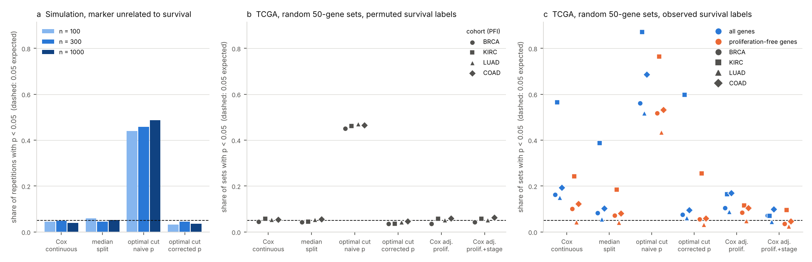

# Random gene signatures and survival in TCGA; optimal cut-point inflation (2026-11-04)

Tracking issue: [#11](https://github.com/shoo99/sbmlab-benchmarks/issues/11). No post yet.

Venet et al. (2011, *PLoS Comput Biol* 7:e1002240) found that most random gene sets were associated with breast cancer outcome, and that the effect ran through proliferation. This folder asks two questions. How often does a random gene set "predict" survival in TCGA today? And how much does picking the "optimal" cut-point inflate a survival p-value?

- **The optimal cut-point is the bigger problem.** The simulated marker has no relation to survival. Still, 44–49% of repetitions give p < 0.05 when the best split is chosen and its log-rank p is reported as if the split had been fixed in advance. The corrected p of the maximally selected statistic keeps this at 3.2–4.4%.
  - The same holds in TCGA with permuted survival labels: 45–47% of random signatures reach p < 0.05.
  - The chosen split also inflates the hazard ratio: under the null, the median high-vs-low HR is 1.56 at n = 300 (truth 1), against 1.14 for the median split.
- **Random signatures "predict" survival in TCGA, and more where proliferation is prognostic.** Share of random 50-gene sets with Cox p < 0.05 (5% expected without any signal):
  - KIRC: 57%
  - COAD: 19%
  - BRCA: 16%
  - LUAD: 15%
- **Adjusting for proliferation and stage removes most of it.** After adjustment, the share of random 50-gene sets with p < 0.05 is:
  - KIRC 7.0%
  - BRCA 7.1%
  - LUAD 4.4%
  - COAD 9.9%

  In KIRC the effect runs largely through proliferation:
  - Sets drawn only from genes uncorrelated with the proliferation score reach p < 0.05 in 24% of cases, against 57% for sets of all genes.
  - The 50 genes most correlated with proliferation lose their association once proliferation is in the model (p 1.8 × 10⁻¹⁵ → 0.26).

## Data

- **Expression**: UCSC Xena TCGA hub, `TCGA.<cohort>.sampleMap/HiSeqV2`. This is gene-level RSEM, log2(normalised count + 1), Illumina HiSeq, 20,530 genes.
- **Survival and stage**: TCGA Pan-Cancer Clinical Data Resource (Liu et al. 2018, *Cell* 173:400), as served by the Xena PanCan Atlas hub (`Survival_SupplementalTable_S1_20171025_xena_sp`). It has the curated OS / DSS / DFI / PFI endpoints and the AJCC pathologic stage.
- **Cohorts**: BRCA, KIRC, LUAD, COAD.
- **Endpoint**: progression-free interval (PFI). Liu et al. discuss endpoint choice per cancer type. BRCA has few deaths within TCGA follow-up, which makes OS a weak endpoint there.
- **Patients**: primary tumours (sample code 01) with the endpoint and time > 0.

  | Cohort | Patients | PFI events |
  |---|---|---|
  | BRCA | 1,081 | 145 (13%) |
  | KIRC | 529 | 159 (30%) |
  | LUAD | 502 | 206 (41%) |
  | COAD | 278 | 81 (29%) |

- **Genes**: above 0 in at least half of the tumours and not constant (17,458–17,763 per cohort). Each gene is z-scored within its cohort.
- `download.sh` fetches about 150 MB into `data/`, which is not tracked. These are the md5 sums of the files used here (downloaded 2026-11-04):

  ```
  50e4e056d3930bb98c51caf5f083d613  Survival_SupplementalTable_S1_20171025_xena_sp
  3ea92ab7e8fcb6102ddca52a44d45002  BRCA_HiSeqV2.gz
  df6a5a9261ca739c6e79c1c98cefd539  KIRC_HiSeqV2.gz
  bcff7dfabf3da82ce215bd2649c4dd4a  LUAD_HiSeqV2.gz
  b36444f3ca1162d9f0936c0a0a583c26  COAD_HiSeqV2.gz
  ```

## Truth

- **Simulation** (`cutpoint_sim.R`):
  - **null**: the marker is independent of survival, so the expected share of p < 0.05 is 0.05 and the true hazard ratio is 1
  - **linear**: HR 1.25 per SD of the marker
  - **threshold**: HR 2 in the top quarter of the marker

  Survival is exponential (rate 0.1 per year) with uniform censoring over 0–10 years, giving about 37% events. 1,000 repetitions per setting.
- **Permuted survival labels** (TCGA): time and event are shuffled together across patients, so no signature can be associated with survival.
  - Each random set gets its own permutation.
  - Each fixed signature gets 200 permutations.
- **Observed labels** (TCGA): there is no ground truth for any one signature. Here the result is the share of random signatures that reach p < 0.05, and how that share changes with adjustment.

## Signatures and analyses

Each signature score is the mean z-score of its genes.

| Signature | Genes |
|---|---|
| random 50-gene sets | 1,000 sets drawn from all expressed genes |
| random 50-gene sets, proliferation-free | 1,000 sets drawn only from genes with \|r\| < 0.2 with the proliferation score (10,148–11,605 genes per cohort) |
| proliferation (PAM50, 11 genes) | BIRC5, CCNB1, CDC20, NUF2, CEP55, NDC80, MKI67, PTTG1, RRM2, TYMS, UBE2C (Nielsen et al. 2010) |
| top 50 proliferation-correlated genes | highest r with the proliferation score, the 11 genes excluded; an in-cohort stand-in for Venet's meta-PCNA |

| Analysis | What is reported |
|---|---|
| Cox, continuous score | Wald p of the score in `coxph` |
| median split | log-rank p, high vs low at the median |
| optimal cut-point, naive p | the split between the 10th and 90th percentile with the largest standardised log-rank statistic (`maxstat`, as `survminer::surv_cutpoint` picks it), then the log-rank p of that split as if fixed in advance |
| optimal cut-point, corrected p | the same search, with the p-value of the maximally selected statistic (`maxstat`, `pmethod = "Lau92"`, Lausen & Schumacher 1992) |
| Cox, adjusted for proliferation | score + proliferation score |
| Cox, adjusted for proliferation and stage | score + proliferation score + AJCC stage (I–IV, sub-stages merged), on patients with a known stage |

## Tools

- R 4.3.3, survival 3.5.8, maxstat 0.7.25, data.table 1.14.10. These are Ubuntu 24.04 packages, the same as CI.
- `survival_tests.R` holds the four analyses, which both scripts use.
- Seeds:
  - `cutpoint_sim.R` calls `set.seed(2026 + setting)` before each setting
  - `tcga_signatures.R` calls `set.seed(11)` before each cohort
  - the synthetic test uses `set.seed(7)`

## How to run

The simulation needs no data:

```bash
Rscript cutpoint_sim.R > cutpoint_sim.out
```

The TCGA part downloads the data, computes every p-value into `tcga_pvalues.csv`, then scores it:

```bash
bash download.sh
```

```bash
Rscript tcga_signatures.R data BRCA KIRC LUAD COAD > tcga_signatures.out
```

```bash
Rscript score.R > score.out
```

```bash
python3 figure.py
```

- **Run times**: `cutpoint_sim.R` takes about 45 s and writes `sim_scores.csv`. `tcga_signatures.R` took 6.5 min for the four cohorts on one core.
- **Bundled table**: `tcga_pvalues.csv` (1.9 MB) has one row per signature, label set and cohort, and one column per analysis.
- **Scoring**: `score.R` needs only the bundled tables. It writes `scores.csv`: the simulation rows, then the TCGA rows.
- **Other options**:
  - `ENDPOINT=OS` (or DSS, DFI) changes the endpoint
  - `N_SETS` and `N_PERM` change the number of random sets and of permutations
  - any Xena cohort name can be passed, for example `bash download.sh LIHC` followed by `Rscript tcga_signatures.R data LIHC`
- **CI**:
  - re-runs `cutpoint_sim.R` and `score.R` and compares their outputs with the bundled files byte for byte
  - runs `test/test_synthetic.R`, which builds data in the format of the two downloads and checks 11 known answers of `tcga_signatures.R`:
    - permuted labels give about 5% p < 0.05 except with the naive cut-point
    - random sets stop "predicting" once proliferation is adjusted for
    - proliferation-free sets do not predict

## Results



### Simulation: share of 1,000 repetitions with p < 0.05

The null rows count false positives (expected 0.05). The other rows give power.

| Setting | Cox continuous | Median split | Optimal cut, naive p | Optimal cut, corrected p |
|---|---|---|---|---|
| null, n = 100 | 0.044 | 0.060 | **0.439** | 0.032 |
| null, n = 300 | 0.048 | 0.044 | **0.457** | 0.044 |
| null, n = 1000 | 0.040 | 0.052 | **0.486** | 0.036 |
| linear HR 1.25/SD, n = 300 | 0.649 | 0.457 | 0.895 | 0.474 |
| threshold top 25% HR 2, n = 300 | 0.748 | 0.523 | 0.986 | 0.827 |

- **Naive p**: its false-positive rate grows with n, because a larger sample allows a finer search.
- **Corrected p**:
  - It is calibrated, and slightly conservative.
  - It costs power for a linear effect (0.47 vs 0.65 for Cox).
  - It beats Cox and the median split when the effect really has a threshold (0.83).
- **Hazard ratio of the chosen split under the null** (truth 1): median HR 2.13 at n = 100, 1.56 at n = 300 and 1.28 at n = 1000. For the median split it is 1.26, 1.14 and 1.08.

### TCGA: share of random 50-gene sets with p < 0.05

Each cell is observed labels / permuted labels.

| Cohort | Cox continuous | Median split | Optimal cut, naive p | Optimal cut, corrected p | Cox adj. proliferation | Cox adj. proliferation + stage |
|---|---|---|---|---|---|---|
| BRCA | 0.162 / 0.044 | 0.082 / 0.043 | 0.561 / 0.450 | 0.075 / 0.036 | 0.104 / 0.036 | 0.071 / 0.042 |
| KIRC | 0.565 / 0.058 | 0.388 / 0.045 | 0.872 / 0.461 | 0.597 / 0.035 | 0.165 / 0.058 | 0.070 / 0.057 |
| LUAD | 0.150 / 0.054 | 0.056 / 0.053 | 0.517 / 0.470 | 0.061 / 0.042 | 0.089 / 0.051 | 0.044 / 0.051 |
| COAD | 0.193 / 0.054 | 0.102 / 0.055 | 0.687 / 0.465 | 0.095 / 0.046 | 0.170 / 0.060 | 0.099 / 0.062 |

**Sets drawn from proliferation-free genes** (observed labels, Cox continuous):

| Cohort | Proliferation-free sets | All-gene sets |
|---|---|---|
| BRCA | 0.101 | 0.162 |
| KIRC | 0.242 | 0.565 |
| LUAD | 0.042 | 0.150 |
| COAD | 0.123 | 0.193 |

**The proliferation signature itself** (Cox p, observed labels):

| Cohort | Cox p |
|---|---|
| BRCA | 0.031 |
| KIRC | 4.4 × 10⁻¹⁷ |
| LUAD | 0.0026 |
| COAD | 0.49 |

`score.out` has every number, including the permutation results of the fixed signatures.

## Traps

- **A cut-point chosen on the data must be tested as chosen.** A Kaplan–Meier plot at the "optimal" cut, with the log-rank p printed on it, looks the same whether the cut was fixed in advance or searched. Under the null, about half of such plots show p < 0.05.
  - `survminer::surv_cutpoint` + `surv_pvalue` is a common route to this.
  - Report the corrected p (`maxstat.test` with a `pmethod`), use the continuous score, or fix the cut-point on other data.
- **"Better than random" is the test a signature has to pass, not p < 0.05.** In KIRC, 57% of random 50-gene sets are prognostic. A published signature that beats a random set has shown little.
- **Proliferation does not explain everything.** In COAD the proliferation score is not prognostic (p 0.49), yet 19% of random sets are, and 12% of proliferation-free sets. Another axis carries the effect there; stromal content is a known candidate in colon cancer, but it is not tested here. In KIRC, proliferation-free sets still reach 24%. Adjusting for stage brings both close to 5–10%.
- **Wald p of a sparse stage level.** In BRCA, stage IV has 20 patients. Its Cox coefficient can diverge in some fits. The warning is suppressed, because it does not affect the p-value of the score.
- **Naming of proliferation genes.** NUF2 and NDC80 have older aliases (CDCA1, KNTC2). All 11 genes are present under their current symbols in the Xena HiSeqV2 files. `tcga_signatures.R` prints how many it found.

## Files

| File | Content |
|---|---|
| `survival_tests.R` | the four survival analyses of one marker (shared) |
| `cutpoint_sim.R`, `cutpoint_sim.out`, `sim_scores.csv` | simulation of cut-point choice |
| `download.sh` | fetches the TCGA expression and the clinical data resource |
| `tcga_signatures.R`, `tcga_signatures.out`, `tcga_pvalues.csv` | p-value of every signature, analysis and label set in each cohort |
| `score.R`, `score.out`, `scores.csv` | scoring from the bundled tables (standard columns) |
| `figure.py`, `random_signatures_tcga.png` | figure from `scores.csv` |
| `test/test_synthetic.R` | known-answer test of `tcga_signatures.R` on synthetic data (CI) |
