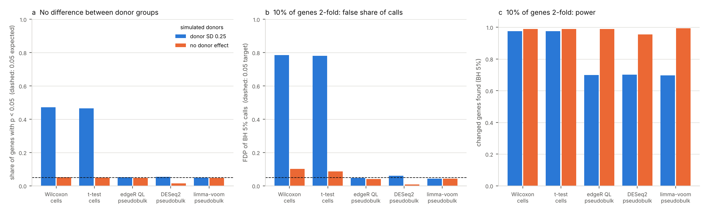

# scRNA-seq: cell-level DE tests vs pseudobulk when donors differ (2026-11-04)

Tracking issue: [#6](https://github.com/shoo99/sbmlab-benchmarks/issues/6). No post yet.

The default tests in Seurat (`FindMarkers`) and Scanpy (`rank_genes_groups`) treat every cell as a replicate. When two groups of *people* are compared, cells from the same donor are not independent. A gene that varies between people then looks different between the groups, even when the groups do not differ. Squair et al. (2021, *Nat Commun* 12:5692) and Zimmerman et al. (2021, *Nat Commun* 12:738) showed this; pseudobulk tests, which sum each donor's cells first, avoid it.

This folder has two parts:

1. **Simulation**: the result is here, and CI re-runs it.
2. **Kang et al. 2018 PBMC from 8 donors** (`kang_study.R`): the scripts are ready and tested on synthetic data in the same file format. The run needs the GEO download, which this repository's cloud environment cannot reach. Run it on a workstation (see *How to run*).

Simulation, 8 donors split 4 vs 4, donor-to-donor SD 0.25:

- **No difference between the groups**:
  - cell-level Wilcoxon and t-test give p < 0.05 for 47% of genes, and 711–720 BH 5% "discoveries" per repetition, all false
  - pseudobulk edgeR, DESeq2 and limma-voom give 4.9–5.3% and no discoveries
- **10% of genes changed 2-fold**:
  - cell-level tests find nearly all changed genes, but 78% of their calls are false
  - pseudobulk tests find 70% of them at 4.3–6.1% false
- **Without donor variation**, cell-level tests are calibrated (5.0–5.1%). The problem is the donor, not the test.

## Data

- **Simulation** (`sim_study.R`):
  - one cell type from 8 donors, with 100–400 cells per donor and 2,000 genes
  - negative binomial counts around gene mean × donor effect × cell size factor:
    - gene mean: log-normal, meanlog −1, sdlog 1.5, so most genes are sparse
    - donor effect: log-normal per gene and donor, SD 0.25, or 0 in the control setting
    - size factor: log-normal per cell, SD 0.3
    - dispersion: 0.2
  - genes detected in fewer than 5% of cells are dropped (about 1,820 remain)
  - 10 repetitions per setting; seeds `set.seed(600 + setting)`
- **Kang et al. 2018** (*Nat Biotechnol* 36:89; GEO [GSE96583](https://www.ncbi.nlm.nih.gov/geo/query/acc.cgi?acc=GSE96583), batch 2):
  - PBMC from 8 lupus patients, pooled and demultiplexed by genotype with demuxlet, so every cell has a donor and a doublet call
  - only the unstimulated (control) cells are used: demuxlet singlets with a cell-type label
  - cell types with at least 20 cells in every donor are used
  - `download.sh` fetches about 110 MB into `data/`, which is not tracked

## Truth

- **Null**:
  - Simulation: the two groups of donors do not differ.
  - Kang: the 8 control donors are split 4 vs 4, and all 35 distinct splits are run. Nothing separates the groups except which people are in them.
  - Either way, every call is false.
- **Planted**:
  - Simulation: 10% of genes are 2-fold higher or lower in every group-B donor.
  - Kang: in 10 of the splits, 10% of the tested genes are changed 2-fold by binomial thinning. Counts in group A cells are thinned to one half for half of the genes (B higher), and counts in group B cells for the other half (B lower). Thinning keeps the data counts and changes only the chosen genes.
  - Power and false discovery proportion (FDP) of BH 5% calls are measured against the changed genes.

## Methods

`de_methods.R` holds all the tests; both studies use it. Every method tests the same genes in each cell type. BH is applied to the raw p-values of every method in the same way; for DESeq2, the p-values are taken before its independent filtering.

| Method | Unit | Details |
|---|---|---|
| Wilcoxon (cells) | cell | rank-sum test on log1p(CP10k), the normal approximation of `wilcox.test(exact = FALSE)` (vectorised; identical p-values); the Seurat and Scanpy default |
| t-test (cells) | cell | Welch t-test on log1p(CP10k) |
| MAST (cells) | cell | hurdle model `~ group + cellular detection rate`, LRT; only with `DE_MAST=1` and MAST installed (not an Ubuntu package; slow) |
| edgeR QL (pseudobulk) | donor | counts summed per donor; TMM, `glmQLFit` / `glmQLFTest` |
| DESeq2 (pseudobulk) | donor | counts summed per donor; Wald test |
| limma-voom (pseudobulk) | donor | counts summed per donor; TMM, `voom`, `lmFit`, `eBayes` |

R 4.3.3, edgeR 4.0.16, DESeq2 1.42.0, limma 3.58.1 (Ubuntu 24.04 packages, the same as CI). A mixed model (cells nested in donors) is not included yet.

## How to run

The simulation needs no data:

```bash
Rscript sim_study.R > sim_study.out
```

```bash
Rscript score.R > score.out
```

```bash
python3 figure.py
```

On a workstation, the Kang study:

```bash
bash download.sh
```

```bash
KANG_CORES=8 Rscript kang_study.R data > kang_study.out
```

```bash
Rscript score.R > score.out
```

- **Simulation**: `sim_study.R` takes about 3.5 min and writes `sim_scores.csv`.
- **Kang study**:
  - `kang_study.R` writes `kang_metrics.csv` (one row per cell type, split, scenario and method) and `kang_versions.csv`.
  - `KANG_CORES` runs the splits in parallel.
  - `DE_MAST=1` adds MAST if it is installed, for example with `conda install -c bioconda bioconductor-mast`.
  - `N_SPLITS`, `N_PLANTED` and `MIN_CELLS` change the design.
- **Scoring**: `score.R` puts the simulation rows and, once `kang_metrics.csv` exists, the Kang rows into `scores.csv`.
- **Checks** before committing the Kang result:
  - `kang_study.out` reports how many barcodes matched the demuxlet table. It stops below 80%.
  - Bundle `kang_metrics.csv`, `kang_versions.csv`, `kang_study.out` and the new `scores.csv`, and add a dated note to this README.
- **CI**:
  - re-runs `sim_study.R` and `score.R` and compares their outputs with the bundled files byte for byte
  - runs `test/test_kang_format.R`, which writes synthetic data in the GSE96583 file layout (with doublets and stimulated cells to be left out), runs `kang_study.R` on it, and checks 13 known answers:
    - cell-level calls are inflated under the null
    - pseudobulk stays near 5%
    - planted genes are found at low FDP
    - only control singlets are used

## Results



**Simulation**, 10 repetitions per setting. The values are means per repetition.

| Method | Null: share p < 0.05 (donor SD 0.25 / none) | Null: false BH calls per repetition (SD 0.25) | Planted: power (SD 0.25) | Planted: FDP (SD 0.25 / none) |
|---|---|---|---|---|
| Wilcoxon (cells) | **0.471** / 0.051 | **719.8** | 0.975 | **0.784** / 0.101 |
| t-test (cells) | **0.465** / 0.050 | **710.7** | 0.975 | **0.782** / 0.087 |
| edgeR QL (pseudobulk) | 0.052 / 0.048 | 0 | 0.698 | 0.046 / 0.041 |
| DESeq2 (pseudobulk) | 0.053 / 0.014 | 0 | 0.701 | 0.061 / 0.007 |
| limma-voom (pseudobulk) | 0.049 / 0.048 | 0 | 0.696 | 0.043 / 0.044 |

`sim_study.out` has every number, including discoveries per repetition.

**Kang 2018**: pending the workstation run.

## Traps

- **Cell-level tests are not wrong tests. They answer a different question**: do these *cells* differ? With donors in the groups, that question has the answer "yes" for every gene that varies between people. Here that is nearly half the genes.
- **More cells make it worse, not better.** The cell-level p-values shrink with the number of cells, while the donor-to-donor difference stays the same.
- **Cell-level FDP stays above target even without donor effects.** With 10% of genes changed and no donor variation, cell-level FDP is 9–10%. Normalising each cell to 10,000 counts lets the changed genes shift the others (a composition effect). Pseudobulk with TMM normalisation stays at 4%.
- **DESeq2 on pseudobulk without donor variation is conservative** (1.4% p < 0.05 at a nominal 5%). Its dispersion estimates do not shrink to the near-Poisson truth.
- **Pseudobulk pays in power for honesty.** With 4 donors per group and donor SD 0.25, a 2-fold change is found 70% of the time. The cell-level 97.5% is not a real advantage, because most of those calls are false.

## Files

| File | Content |
|---|---|
| `de_methods.R` | the DE tests and per-repetition summaries (shared) |
| `sim_study.R`, `sim_study.out`, `sim_scores.csv` | simulation with donor effects |
| `download.sh` | fetches GSE96583 batch 2 (Kang et al. 2018) |
| `kang_study.R` | null donor splits and planted changes in Kang control PBMC (workstation) |
| `score.R`, `score.out`, `scores.csv` | scoring from the bundled tables (standard columns) |
| `figure.py`, `scrna_pseudobulk_de.png` | figure from `scores.csv` |
| `test/test_kang_format.R` | known-answer test of `kang_study.R` on synthetic data in the GEO file layout (CI) |
