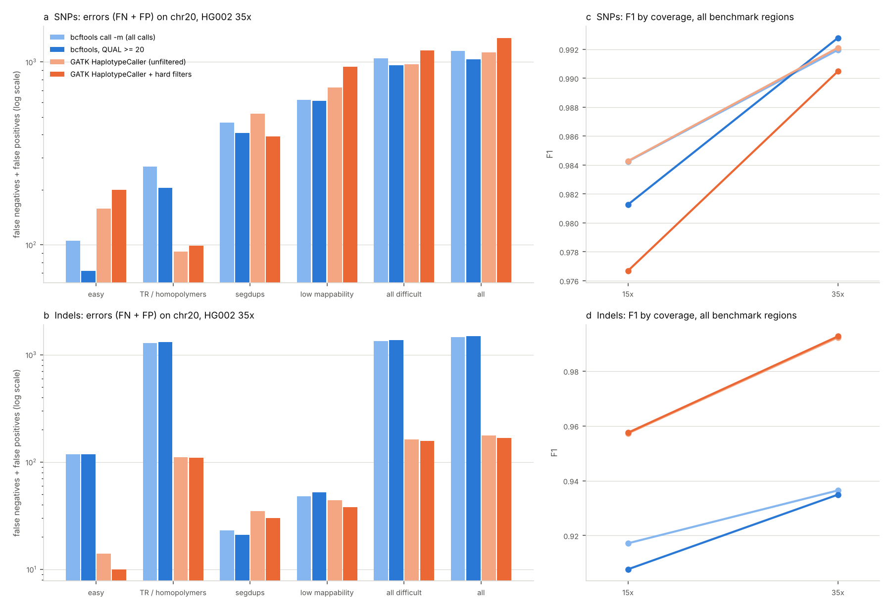

# Germline variant calling on GIAB HG002 chr20: bcftools vs GATK HaplotypeCaller (DeepVariant on a workstation; 2026-11-04)

Tracking issue: [#14](https://github.com/shoo99/sbmlab-benchmarks/issues/14). Post: [bcftools vs GATK HaplotypeCaller, Scored Against GIAB HG002](https://sbmlab.com/blog/variant-calling-bcftools-vs-gatk-giab-hg002-benchmark) (2026-11-14; [Korean](https://sbmlab.com/blog/variant-calling-bcftools-vs-gatk-giab-hg002-benchmark-ko)).

How do the common germline small-variant callers compare against a curated truth set, and where do they fail? We used one BAM (Genome in a Bottle HG002, chromosome 20), scored against the GIAB v4.2.1 benchmark with hap.py, overall and in the GIAB difficult-region strata.

- **On SNPs, bcftools and GATK HaplotypeCaller tie** at 35×: F1 0.992. Both miss about 430 of 71,333 truth SNPs and make about 710 false calls. In regions outside every difficult stratum, F1 is 0.999 for both.
- **On indels, GATK is far ahead**: F1 0.992 vs 0.937. Of 11,256 truth indels, bcftools misses 781 (GATK 97). Of bcftools' 675 false indel calls, 592 are the right allele with the wrong genotype (GATK: 80 false indel calls in all).
- **GATK's recommended hard filters cost SNP recall.** SNP F1 drops from 0.9921 to 0.9905. The filters remove 356 false SNPs but also 580 true ones. Of those 580, 413 are in low-mappability regions (recall there 0.867 → 0.715); `MQ < 40` flags 382 of the 580 and `SOR > 3` flags 211 (a call can fail both). On indels the filters help slightly.
- **On SNPs, every call set is worst in segmental duplications and low-mappability regions.** There, SNP F1 is 0.81–0.88, against 0.998–0.999 in the easy regions. In segmental duplications the errors are mostly false positives: SNP precision is 0.77–0.83 at recall 0.92–0.95.
- **At 15×, F1 drops and filtering hurts more.**
  - SNP F1 falls to 0.984 for both callers. With hard filters it is 0.977; with QUAL ≥ 20 for bcftools, 0.981.
  - Indel F1 falls to 0.957 for GATK and 0.917 for bcftools.
  - Filters tuned for typical coverage remove more true calls when the coverage is lower.
- **DeepVariant is not in these numbers yet.** The cloud environment could not run it, so `run.sh` has a DeepVariant step for a workstation (see *How to run*).

## Data

All inputs are public; `download.sh` fetches about 2.2 GB into `data/`, which is not tracked.

| Input | Source | md5 (as downloaded 2026-11-04) |
|---|---|---|
| HG002 (NA24385) Illumina NovaSeq PCR-free WGS, 35×, BWA-MEM to GRCh38 no-alt, duplicates marked, chr20 only (`HG002.novaseq.pcr-free.35x.dedup.grch38_no_alt.chr20.bam`) | the DeepVariant case-study input, Google Cloud Storage bucket `deepvariant` | `8f1a541a348803e304275359ac52da57` |
| GRCh38 no-alt analysis set (GCA_000001405.15) | GIAB S3 mirror, `release/references/GRCh38/` | `3a3347eae0893f96ecf495d1c39e2284` (.fasta.gz) |
| GIAB HG002 v4.2.1 benchmark, GRCh38: VCF and regions without inconsistent sites | GIAB S3, `release/AshkenazimTrio/HG002_NA24385_son/NISTv4.2.1/GRCh38/` | `dc750b3807d4af1f7ffec852e9c2f771` (VCF), `97265e922a97c69a0391cf3f92a89b8b` (BED) |
| GIAB genome stratifications v3.3, GRCh38 | GIAB S3, `release/genome-stratifications/v3.3/GRCh38@all/` | in `data/md5.txt` after `download.sh` |

**On chr20, inside the benchmark regions** (57.0 Mb), the truth has 71,333 SNPs and 11,256 indels.

**The 15× set** is the same BAM downsampled with `samtools view -s 7.4286` (seed 7, keeping 42.9% of read pairs).

## Truth and strata

The benchmark regions are where GIAB is confident about HG002's genotype; outside them nothing is scored. Within them, hap.py reports each GIAB v3.3 stratum separately:

| Stratum | GIAB file | chr20 benchmark size | Truth SNPs |
|---|---|---|---|
| not in any difficult region ("easy") | `GRCh38_notinalldifficultregions` | 49.8 Mb | 60,394 |
| all difficult regions | `GRCh38_alldifficultregions` | 7.2 Mb | 10,939 |
| tandem repeats and homopolymers | `GRCh38_AllTandemRepeatsandHomopolymers_slop5` | 2.8 Mb | 3,970 |
| segmental duplications | `GRCh38_segdups` | 0.93 Mb | 1,510 |
| low mappability | `GRCh38_lowmappabilityall` | 1.3 Mb | 2,723 |

## Callers and scoring

All callers read the same BAM and run on 4 CPU threads. The versions are from bioconda.

| Call set | How |
|---|---|
| bcftools call -m (all calls) | bcftools 1.25: `mpileup -q 20 -Q 20 -d 250 -a AD,DP` piped into `call -mv` |
| bcftools, QUAL >= 20 | the same calls, without those flagged `LowQual` (QUAL < 20) |
| GATK HaplotypeCaller (unfiltered) | GATK 4.6.2.0, default settings, with chr20 split into 4 equal pieces run in parallel and joined |
| GATK HaplotypeCaller + hard filters | GATK's recommended hard filters as FILTER flags. SNPs: QD < 2, FS > 60, MQ < 40, MQRankSum < −12.5, ReadPosRankSum < −8, SOR > 3. Indels: QD < 2, FS > 200, ReadPosRankSum < −20, SOR > 10. The guide's QUAL < 30 is left out: HaplotypeCaller does not emit calls below QUAL 30 by default |
| DeepVariant (workstation) | DeepVariant 1.10.0, WGS model, from the official Docker image |

- **VQSR is not run.** It needs a whole genome's worth of variants or many samples, plus external resource panels.
- **Alignment is not compared.** Every caller reads the same BWA-MEM alignment.
- **hap.py** 0.3.15 runs with the vcfeval engine (rtg-tools 3.13) against the chr20 truth, inside the benchmark regions, with the strata above. hap.py's own `Filter` column separates all calls (`ALL`) from passing calls (`PASS`).
- **`score.py`** reads the trimmed hap.py tables in `happy/` and `timings.tsv`, and writes `scores.csv`. Its metrics are recall, precision, F1, false negatives and false positives per call set, variant type and region, plus run time and peak memory.

## How to run

The three conda environments, from bioconda and conda-forge:

```bash
micromamba create -p ./envs/vc -c conda-forge -c bioconda gatk4=4.6.2.0 bcftools=1.25 samtools=1.25 rtg-tools=3.13
```

```bash
micromamba create -p ./envs/happy -c conda-forge -c bioconda hap.py=0.3.15 rtg-tools=3.13
```

DeepVariant runs from Docker (`docker pull google/deepvariant:1.10.0`). Then:

```bash
bash download.sh
```

```bash
VC_BIN=envs/vc/bin HAPPY_BIN=envs/happy/bin PATH=envs/happy/bin:envs/vc/bin:$PATH bash run.sh
```

```bash
COVERAGE=15 VC_BIN=envs/vc/bin HAPPY_BIN=envs/happy/bin PATH=envs/happy/bin:envs/vc/bin:$PATH bash run.sh bcftools gatk deepvariant happy
```

```bash
python3 score.py > score.out && python3 figure.py
```

- **`run.sh` steps**: `prepare`, `bcftools`, `gatk`, `deepvariant`, `happy`. Each step can be run on its own.
- **DeepVariant**: `DV_RUN` replaces the Docker call, for example with a Singularity command that runs `run_deepvariant`.
- **Outputs**:
  - VCFs go to `work/`, which is not tracked.
  - Trimmed hap.py tables go to `happy/`.
  - Wall time, CPU time and peak memory go to `timings.tsv`.
- **Do not edit `run.sh` while it runs.** bash reads a script as it goes, and an edit in the middle broke the end of one run here (after its output was complete).
- **Run here**:
  - in Claude Code's cloud container (4 cores, 15 GB RAM) on 2026-11-04
  - re-run on a workstation (WSL2) on 2026-11-13, from a fresh `download.sh` (md5 sums matched) with the same bioconda versions: all four `happy/` tables were byte for byte identical. Its run times are not comparable (the machine was running other jobs), so `timings.tsv` keeps the cloud times. With both environments on `PATH`, put `envs/vc/bin` first for the calling steps (GATK needs its Java 17; the happy env brings Java 11) and `envs/happy/bin` first for the `happy` step (hap.py needs that env's Python 2).
  - DeepVariant could not run there. The bioconda `deepvariant` 1.10.0 package installs only placeholder wrappers, without binaries or models, and running the downloaded DeepVariant binaries directly was not permitted in that environment. Docker was not available either.
- **CI** re-runs `score.py` from the bundled hap.py tables and compares `scores.csv` and `score.out` byte for byte. It also runs `figure.py`.

## Results



**35×, all benchmark regions**:

| Call set | SNP recall | SNP precision | SNP F1 | Indel recall | Indel precision | Indel F1 |
|---|---|---|---|---|---|---|
| bcftools call -m (all calls) | 0.994 | 0.990 | 0.9920 | 0.931 | 0.942 | 0.9365 |
| bcftools, QUAL >= 20 | 0.993 | 0.992 | 0.9928 | 0.925 | 0.945 | 0.9349 |
| GATK HaplotypeCaller (unfiltered) | 0.994 | 0.990 | 0.9921 | 0.991 | 0.993 | 0.9923 |
| GATK HaplotypeCaller + hard filters | 0.986 | 0.995 | 0.9905 | 0.991 | 0.994 | 0.9927 |

**35×, F1 by region**:

| Call set | Easy | All difficult | TR / homopolymers | Segdups | Low mappability |
|---|---|---|---|---|---|
| SNP, bcftools (all calls) | 0.9991 | 0.953 | 0.968 | 0.860 | 0.883 |
| SNP, GATK (unfiltered) | 0.9987 | 0.956 | 0.989 | 0.846 | 0.867 |
| SNP, GATK + hard filters | 0.9983 | 0.946 | 0.988 | 0.877 | 0.805 |
| Indel, bcftools (all calls) | 0.983 | 0.917 | 0.916 | 0.919 | 0.830 |
| Indel, GATK (unfiltered) | 0.998 | 0.990 | 0.993 | 0.889 | 0.862 |
| Indel, GATK + hard filters | 0.999 | 0.990 | 0.993 | 0.903 | 0.878 |

**15× (downsampled), all benchmark regions**:

| Call set | SNP recall | SNP precision | SNP F1 | Indel recall | Indel precision | Indel F1 |
|---|---|---|---|---|---|---|
| bcftools call -m (all calls) | 0.982 | 0.987 | 0.9842 | 0.900 | 0.935 | 0.9172 |
| bcftools, QUAL >= 20 | 0.972 | 0.991 | 0.9813 | 0.878 | 0.940 | 0.9077 |
| GATK HaplotypeCaller (unfiltered) | 0.982 | 0.986 | 0.9843 | 0.943 | 0.972 | 0.9573 |
| GATK HaplotypeCaller + hard filters | 0.965 | 0.988 | 0.9767 | 0.943 | 0.972 | 0.9575 |

**Run time on chr20** (4 threads):

| Caller | Coverage | Wall time | CPU time | Peak memory of one process |
|---|---|---|---|---|
| bcftools | 35× | 3.7 min | 4.1 min | 107 MB |
| bcftools | 15× | 2.1 min | 2.5 min | 108 MB |
| GATK HaplotypeCaller | 35× | 17.4 min | 58 min | 3.1 GB |
| GATK HaplotypeCaller | 15× | 12.2 min | 44 min | 1.6 GB |

`bcftools mpileup` is single-threaded; `--threads` only speeds up compression. GATK ran as 4 processes, one per piece of chr20. `score.out` has every number, including the 15× run.

## Traps

- **The genotype matters for indels.** Most of bcftools' false indel calls (592 of 675) have the right allele but the wrong genotype, typically het vs hom-alt. A comparison that checks only alleles would rate bcftools much higher.
- **Hard filters are not free.** `MQ < 40` removes true SNPs in low-mappability regions, which is where most of the 580 lost true SNPs are (413; `MQ < 40` flags 382 of the 580). Check filter thresholds against a truth set before applying them to a new data type.
- **The scattered GATK run joins four pieces.** A variant spanning a piece boundary could in principle be lost or doubled. We checked ±300 bp around each of the 3 boundaries. Near the first, all 8 truth variants were called once each; near the other two there are no truth variants.
- **Coverage, region and sample all limit generalisation.** These are one sample, one chromosome and one library type (NovaSeq PCR-free). PCR-amplified libraries are known to have many more indel errors in homopolymers.

## Files

| File | Content |
|---|---|
| `download.sh` | fetches the BAM, reference, truth and strata |
| `run.sh` | prepare, bcftools, GATK, DeepVariant and hap.py steps |
| `happy/<caller>_<coverage>x.extended.csv` | hap.py results, trimmed to the rows scored here |
| `timings.tsv` | wall and CPU time and peak memory per caller and coverage |
| `score.py`, `score.out`, `scores.csv` | scoring from the bundled tables (standard library) |
| `figure.py`, `variant_calling_giab.png` | the figure |
